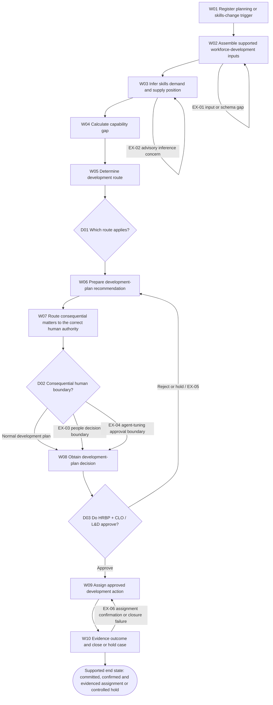
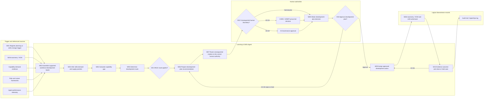

# Learning Skills Agent Stage 3 – Decompose

# Document Control

| Control Item | Details | Evidence |
| --- | --- | --- |
| Document title | Learning Skills Agent Stage 3 – Decompose. | [SRC-01, output location and final deliverable]; [SRC-05, Document Control] |
| Source-approved business agent name | Learning & Skills Agent (`HR-ETG-001`). The requested folder and filename use Workforce Skills Agent and remain subject to ACO-08 / TBC-09. | [SRC-02, Part 1 value stream table]; [SRC-02, section 6.2 Learning & Skills Agent]; [SRC-01, output location and final deliverable] |
| Version | Draft v0.1. | [SRC-05, Document Control] |
| Status | Draft for SME review. | [SRC-01, evidence sufficiency and controlled gaps]; [SRC-04, section 11.8 Acceptance gate] |
| Prepared by | GitHub Copilot Coding Agent drafting support within the repository task context. | [SRC-01, repository_context] |
| Prepared for | SME review, delivery review and Stage 3 governance review. | [SRC-05, Document Control]; [SRC-04, section 12 Completion response] |
| Date | 17 September 2026. | [SRC-01, current_datetime] |
| Classification | KPMG Confidential. | [SRC-05, title block] |
| Approval required from | Business SME, Technical / Delivery Lead and Stage 3 approver roles are structurally required, but named reviewers and sign-off evidence are not supplied; see ACO-01 / TBC-01. | [SRC-05, Review and Approval]; [SRC-01, controlled gaps item 1] |
| Review purpose | Confirm that the decomposition accurately reflects the Learning & Skills Agent business capability, workflow, handovers, decisions, exceptions and human-control model without inventing unsupported facts. | [SRC-05, Review purpose]; [SRC-03, section 4 Source approval and evidence rules] |

## Version History

| Version | Date | Author | Summary of Change | Status | Evidence |
| --- | --- | --- | --- | --- | --- |
| 0.1 | 17 September 2026 | GitHub Copilot Coding Agent | Initial evidence-based Stage 3 artefact set generated for SME review using the approved capability catalogue and governing Stage 3 repository artefacts. | Draft for SME review | [SRC-01, problem_statement]; [SRC-02, approved Stage 2 output statement] |

## Review and Approval

| Role | Name | Review / Approval | Date | Evidence / Reference |
| --- | --- | --- | --- | --- |
| Business SME | Not yet evidenced (TBC-01) | Pending | Not yet evidenced | [SRC-01, controlled gaps item 1]; [SRC-05, Review and Approval] |
| Technical / Delivery Lead | Not yet evidenced (TBC-01) | Pending | Not yet evidenced | [SRC-01, controlled gaps item 1]; [SRC-05, Review and Approval] |
| Stage 3 Approver | Not yet evidenced (TBC-01) | Pending | Not yet evidenced | [SRC-01, controlled gaps item 1]; [SRC-05, Review and Approval] |

# Table of Contents

- [1. Executive Summary](#1-executive-summary)
- [2. Stage 3 Activities and Outputs](#2-stage-3-activities-and-outputs)
- [3. Step 1 – Review and Understand the Capability](#3-step-1--review-and-understand-the-capability)
  - [3.1 Capability Summary](#31-capability-summary)
  - [3.2 Capability Boundary](#32-capability-boundary)
  - [3.3 Success Measures](#33-success-measures)
  - [3.4 Assumptions, Constraints and Open Questions](#34-assumptions-constraints-and-open-questions)
  - [3.5 Controlled Missing-Information Markers](#35-controlled-missing-information-markers)
- [4. Step 2 – Overall AI Framework](#4-step-2--overall-ai-framework)
- [5. Step 3 – End-to-End Workflow](#5-step-3--end-to-end-workflow)
  - [5.1 Workflow Purpose and Scope](#51-workflow-purpose-and-scope)
  - [5.2 High-Level Process Map](#52-high-level-process-map)
  - [5.3 High-Level Workflow Sequence](#53-high-level-workflow-sequence)
- [6. Step 4 – Decompose into Workflow Steps](#6-step-4--decompose-into-workflow-steps)
  - [6.1 Detailed Workflow Diagram](#61-detailed-workflow-diagram)
  - [6.2 Workflow Decomposition Catalogue](#62-workflow-decomposition-catalogue)
- [7. Step 5 – Handovers and Interactions](#7-step-5--handovers-and-interactions)
  - [7.1 Interface and Dependency Register](#71-interface-and-dependency-register)
- [8. Decisions, Exceptions and Human Intervention Points](#8-decisions-exceptions-and-human-intervention-points)
  - [8.1 Decision Catalogue](#81-decision-catalogue)
  - [8.2 Exception Catalogue](#82-exception-catalogue)
  - [8.3 Human Intervention Points](#83-human-intervention-points)
- [9. Steps 6 and 7 – SME Validation and Confirmation](#9-steps-6-and-7--sme-validation-and-confirmation)
  - [9.1 SME Walkthrough Checklist](#91-sme-walkthrough-checklist)
  - [9.2 Validation Actions and Resolution Log](#92-validation-actions-and-resolution-log)
  - [9.3 SME Confirmation and Approval Status](#93-sme-confirmation-and-approval-status)
- [10. Completion and Quality Checklist](#10-completion-and-quality-checklist)
- [Appendix A – Glossary and Acronyms](#appendix-a--glossary-and-acronyms)
- [Appendix B – Source and Evidence Register](#appendix-b--source-and-evidence-register)
- [Appendix C – Stage 3 to Stage 4 Handover](#appendix-c--stage-3-to-stage-4-handover)

# 1. Executive Summary

This Stage 3 draft decomposes the **Learning & Skills Agent** (`HR-ETG-001`) for the **Talent Design to Evaluate** value stream and preserves the evidenced capability of **Continuous Workforce Development**. The approved source ties the agent to the client outcome **capability gaps closed faster and cheaper; higher mobility and AI literacy; ratings kept human**. The requested output path and filename use **Workforce Skills Agent**, but the source-approved business agent name remains **Learning & Skills Agent** pending the naming resolution item **ACO-08 / TBC-09**. [SRC-02, Part 1 value stream table]; [SRC-02, section 6.2 Learning & Skills Agent]; [SRC-01, output location and final deliverable]

The capability purpose is to **develop the whole workforce — build human skills and AI literacy, and continuously improve the agent workforce — so capability keeps pace with an AI-first operating model**. The supported behaviour chain is **Infer -> Gap -> Route -> Recommend -> (human) -> Assign**. The direct business inputs are skills taxonomy, demand and supply; capability gaps and agentifiable ceilings; role and career frameworks; and agent performance telemetry. The directly evidenced written output is **`DevelopmentPlan: capability, gap, route`**. [SRC-02, section 5.2 Purpose]; [SRC-02, section 5.2 Behaviours]; [SRC-02, section 5.2 Inputs]; [SRC-02, section 5.2 Outputs]

The source states that **skills inference is probabilistic and build-next**, while **gap arithmetic and development-route determination are deterministic** using the supported `skills_gap` and `dev_route` business capabilities. The approved source also states **no autonomous rating or promotion**, **development recommendations advisory only**, **human owns career and rating decisions**, and **agent tuning logged and reversible**. The agent ID card records autonomy as **L1-L3 (proposed)**, which this draft preserves only as a proposed posture rather than an approved operational autonomy level. [SRC-01, capability evidence to preserve]; [SRC-02, section 5.2 Deterministic calculation requirements]; [SRC-02, section 5.2 Governance & compliance controls]; [SRC-02, section 6.2 Learning & Skills Agent, Autonomy]

The coherent workflow in this draft begins from the supported trigger **planning OR skills change**, assembles the supported workforce-development inputs, performs advisory skills inference, calculates the deterministic capability gap, determines the route, prepares a DevelopmentPlan recommendation, applies the human-boundary checks for consequential people or agent-tuning matters, obtains **HRBP + CLO / L&D** approval, assigns the approved development action through the logical systems-of-record pathway, and closes only when outcome evidence is confirmed. Promotion, pay-affecting development, formal performance decisions and scope-changing agent retraining remain human-led or human-approved. [SRC-02, section 5.2 Human-in-the-loop boundary]; [SRC-02, section 6.2 Learning & Skills Agent, Systems of record and Generic agent script]; [SRC-02, section 7 Agent collaboration matrix]

The evidence set is **sufficient with gaps** and supports a **Draft for SME review**, not a review-ready or Stage 3-complete deliverable. Open items remain for SME walkthrough evidence, owner resolution, technical metadata, measure baselines and targets, exception and end-state detail, data and interface governance, methodology-source approval metadata, and the Learning & Skills Agent versus Workforce Skills Agent naming mismatch. All such gaps are registered through **ACO-01 to ACO-08**, **TBC-01 to TBC-09** and **VAL-01 to VAL-08**. [SRC-01, evidence sufficiency and controlled gaps]; [SRC-04, sections 6, 11.8 and 12]

# 2. Stage 3 Activities and Outputs

| Step | Activity | Capability-specific output / evidence | Source evidence |
| --- | --- | --- | --- |
| 1 | Review and understand the capability | Capability summary, boundary, success measures, gap register and controlled TBC records for HR-ETG-001. | [SRC-06, Stage 3 activities item 1]; [SRC-02, section 5.2 Talent Design to Evaluate - Continuous Workforce Development]; [SRC-02, section 6.2 Learning & Skills Agent] |
| 2 | Create the Overall AI Framework | Logical business framework covering purpose, users, trigger, inputs, outputs, dependencies, controls, human guardrails and constraints. | [SRC-06, Stage 3 activities item 2]; [SRC-04, section 9.5 Overall AI Framework]; [SRC-02, sections 4 to 6.2] |
| 3 | Map the end-to-end workflow | High-level sequence from planning or skills-change trigger to approved development assignment or controlled hold. | [SRC-06, Stage 3 activities item 3]; [SRC-02, section 6.2 Learning & Skills Agent, Generic agent script]; [SRC-03, section 12 Workflow decomposition rules] |
| 4 | Decompose into workflow steps | Workflow catalogue W01-W10 with performers, operations, decisions, exceptions and evidence. | [SRC-06, Stage 3 activities item 4]; [SRC-04, sections 7.2 and 9.7] |
| 5 | Define handovers and interactions | Handover and dependency registers covering approvals, consequential human routing, logical write-back and governance logging. | [SRC-06, Stage 3 activities item 5]; [SRC-04, sections 9.8 and 10.4]; [SRC-02, sections 4.1, 4.4 and 7] |
| 6 | Validate with SME | Walkthrough checklist and open validation actions prepared; no completed SME validation evidence is supplied. | [SRC-06, Stage 3 activities item 6]; [SRC-01, controlled gaps item 1]; [SRC-04, section 9.12 SME Validation and Confirmation] |
| 7 | Obtain SME confirmation | Confirmation section retained as pending and not evidenced; Stage 3 completion is not claimed. | [SRC-06, Stage 3 activities item 7]; [SRC-04, sections 11.8 and 12] |

## 2.1 Inputs from Stage 2

The capability catalogue is treated as the user-confirmed approved Stage 2 output and sole capability-fact source for this draft. No separate repository-stored approval record, named approver list or approval date was supplied, so that metadata is carried as **ACO-01 / TBC-01** rather than invented. [SRC-01, required source files; approval status for the capability catalogue]; [SRC-04, section 6 Sufficiency assessment]

## 2.2 Outputs of Stage 3

The artefact set created under `Script/Stage 3/SampleOutput/H2R/Learning Skills Agent/` comprises this integrated Markdown deliverable and the reconciled CSV registers listed below. [SRC-01, output location and final deliverable]; [SRC-03, section 6 Expected outputs]

- `Workforce_Skills_Agent_Stage3_Decompose.md`
- `Workflow_Decomposition_Catalogue.csv`
- `Handover_and_Interaction_Register.csv`
- `Interface_and_Dependency_Register.csv`
- `Decision_Catalogue.csv`
- `Exception_Catalogue.csv`
- `Human_Intervention_Points.csv`
- `Assumptions_Constraints_Open_Questions.csv`
- `Validation_Actions_and_Resolution_Log.csv`
- `Source_and_Evidence_Register.csv`

# 3. Step 1 – Review and Understand the Capability

This step summarises the approved capability facts, defines the business boundary, records the available success measures, and carries forward unresolved items without treating missing evidence as approval or completion. [SRC-06, Stage 3 activities item 1]; [SRC-03, sections 4, 10 and 15]

## 3.1 Capability Summary

| Area | Definition | Evidence |
| --- | --- | --- |
| Business capability | Continuous Workforce Development in the Talent Design to Evaluate value stream. | [SRC-02, Part 1 value stream table]; [SRC-02, section 6.2 Learning & Skills Agent, Capability] |
| Business outcome | Capability gaps closed faster and cheaper; higher mobility and AI literacy; ratings kept human. | [SRC-02, Part 1 value stream table] |
| Business agent name | Learning & Skills Agent. The requested file path uses Workforce Skills Agent and is carried as a naming open question under ACO-08 / TBC-09. | [SRC-02, Part 1 value stream table]; [SRC-02, section 6.2 Learning & Skills Agent]; [SRC-01, output location and final deliverable] |
| Agent ID | HR-ETG-001. | [SRC-02, section 6.2 Learning & Skills Agent, Agent ID] |
| Owner labels evidenced in source | Owner label in the registry and ID card is HRBP + CLO / L&D; CHRO / HRBP own development, mobility and performance decisions; AI Governance owns agent-tuning approvals. The owner-category split remains unresolved under ACO-02 / TBC-02. | [SRC-02, section 4.2 Agent registry]; [SRC-02, section 5.2 Human-in-the-loop boundary]; [SRC-02, section 6.2 Learning & Skills Agent, Owner] |
| Evidenced users or approvers | HRBP and CLO are evidenced as plan approvers; CHRO / HRBP and AI Governance are evidenced as consequential decision authorities. A broader user-persona model is not supplied. | [SRC-02, section 5.2 Use case]; [SRC-02, section 5.2 Human-in-the-loop boundary]; [SRC-02, section 6.2 Learning & Skills Agent, Generic agent script] |
| Status / maturity | Build-next; human learning and mobility recommendation is proven, while continuous closed-loop agent improvement is Emerging. | [SRC-02, section 4.2 Agent registry]; [SRC-02, section 5.2 Maturity / demo posture]; [SRC-02, section 6.2 Learning & Skills Agent, Status] |
| Autonomy posture | L1-L3 (proposed). This draft treats that as a proposed posture only, not an approved operational autonomy level. | [SRC-02, section 6.2 Learning & Skills Agent, Autonomy]; [SRC-01, final document requirements] |
| Primary purpose | Develop the whole workforce — build human skills and AI literacy, and continuously improve the agent workforce — so capability keeps pace with an AI-first operating model. | [SRC-02, section 5.2 Purpose] |
| Trigger | Planning OR skills change. | [SRC-02, section 6.2 Learning & Skills Agent, Generic agent script]; [SRC-01, capability evidence to preserve] |
| Behaviour chain | Infer -> Gap -> Route -> Recommend -> (human) -> Assign. | [SRC-02, section 5.2 Behaviours] |

## 3.2 Capability Boundary

| Boundary Type | Definition | Evidence |
| --- | --- | --- |
| In scope | Business-level intake of the supported trigger, advisory inference of skills demand and supply, deterministic gap and route determination, preparation of DevelopmentPlan recommendations, human approval, governed assignment and evidence capture. | [SRC-02, section 5.2 Behaviours]; [SRC-02, section 5.2 Outputs]; [SRC-02, section 6.2 Learning & Skills Agent, Generic agent script]; [SRC-04, section 9.6 End-to-End Workflow] |
| Out of scope | Stage 4 agent classification, model selection, deployment design, API/interface design, physical schema design, autonomous performance rating, autonomous promotion decisions and any unsupported system detail. | [SRC-02, section 5.2 Deterministic calculation requirements]; [SRC-02, section 5.2 Human-in-the-loop boundary]; [SRC-03, section 14 Stage boundary] |
| Autonomy boundary | Skills inference is advisory and human-reviewed; gap arithmetic and route determination are deterministic as stated; development recommendations are advisory only; no autonomous rating or promotion. | [SRC-01, capability evidence to preserve]; [SRC-02, section 5.2 Deterministic calculation requirements]; [SRC-02, section 5.2 Governance & compliance controls] |
| Mandatory guardrails | Human approval for consequential recommendations; human-led development, mobility, performance, promotion and pay-affecting decisions; AI Governance approval for scope-changing tuning; agent tuning logged and reversible; segregation of duties and audit evidence. | [SRC-02, sections 4.3, 4.4 and 5.2 Human-in-the-loop boundary/Governance & compliance controls]; [SRC-03, section 10 Governance and human-approval rules] |
| Dependencies | Skills taxonomy/HCM, LMS, capability-demand evidence, role and career frameworks, agent performance telemetry, HRBP + CLO / L&D approval, CHRO / HRBP consequential authority and AI Governance approval. | [SRC-02, section 5.2 Inputs]; [SRC-02, section 6.2 Learning & Skills Agent, Systems of record]; [SRC-02, section 7 Agent collaboration matrix] |
| Supported end-state boundary | The workflow can close only after the approved development assignment is committed, confirmed and evidenced, or remain in controlled hold where confirmation or evidence is incomplete. Exact end-state criteria remain unresolved under ACO-05 / TBC-06. | [SRC-02, section 6.2 Learning & Skills Agent, Systems of record and Generic agent script]; [SRC-02, section 4.4 Audit trail schema]; [SRC-01, controlled gaps item 5] |

## 3.3 Success Measures

| ID | Measure | Baseline | Target | Method / Evidence | Owner | Evidence |
| --- | --- | --- | --- | --- | --- | --- |
| SM-01 | Gap and route correctness against a worked reference | Not yet evidenced | Not yet evidenced | Use a worked reference for deterministic gap and route outputs; detailed test method and cadence remain unresolved under TBC-05. | Not yet evidenced — owner resolution required | [SRC-02, section 5.2 Evaluation criteria]; [SRC-01, controlled gaps item 4] |
| SM-02 | Internal-mobility fill rate | Not yet evidenced | Not yet evidenced | Track mobility outcomes from approved development plans; baseline, target and accountable owner remain unresolved under TBC-05. | Not yet evidenced — owner resolution required | [SRC-02, section 5.2 Evaluation criteria]; [SRC-01, controlled gaps item 4] |
| SM-03 | Skills-inference precision and recall once built | Not yet evidenced | Not yet evidenced | Evaluate inference quality only once the build-next skills inference component exists; detailed method remains unresolved under TBC-05. | Not yet evidenced — owner resolution required | [SRC-02, section 5.2 Evaluation criteria]; [SRC-01, controlled gaps item 4] |
| SM-04 | Adverse-impact monitoring on development recommendations | Not yet evidenced | Not yet evidenced | Monitor development recommendation outcomes for adverse impact once sufficient operating data exists; owner and full method remain unresolved under TBC-05. | Not yet evidenced — owner resolution required | [SRC-02, sections 5.2 Risks and 5.2 Evaluation criteria]; [SRC-01, controlled gaps item 4] |

## 3.4 Assumptions, Constraints and Open Questions

| ACO ID | Type | Description | Impact | Owner resolution | Resolution action | Status | Affected sections | Evidence |
| --- | --- | --- | --- | --- | --- | --- | --- | --- |
| ACO-01 | Open question | No supplied SME walkthrough, confirmation record, reviewer names, approval dates or sign-off evidence are available for this Stage 3 draft; see TBC-01. | The document may support SME review, but it cannot claim SME validation, approval or Stage 3 completion. | Not yet evidenced — owner resolution required | Obtain walkthrough attendees, review outcomes, confirmation statements, approval evidence and dated sign-off records. | Open — pending SME review evidence | Document Control; Review and Approval; Section 9; Section 10 | [SRC-01, controlled gaps item 1]; [SRC-03, section 10 Governance and human-approval rules]; [SRC-04, sections 9.12 and 11.8] |
| ACO-02 | Open question | Ownership remains ambiguous between the agent owner/approver label “HRBP + CLO / L&D”, the source statement that “CHRO / HRBP” own development, mobility and performance, and the statement that AI Governance owns agent-tuning approvals; see TBC-02. | Business owner, control owner, approval authority and escalation boundaries cannot be finalised without SME clarification. | Not yet evidenced — owner resolution required | Confirm the accountable business owner, control owner, approver roles and escalation authorities for each consequential decision type. | Open — ownership clarification required | Section 3; Section 4; Section 7; Section 8; Section 9; Appendix C | [SRC-01, controlled gaps item 2]; [SRC-02, sections 4.2, 4.3, 5.2 Human-in-the-loop boundary and 6.2 Learning & Skills Agent]; [SRC-03, section 8 Ownership terminology] |
| ACO-03 | Open question | Technical owner, criticality, risk, model and deployment remain unresolved or proposed-only build-next metadata; see TBC-03 and TBC-04. | Technical governance metadata can be recorded only as unresolved carry-forward, not as approved operational design facts. | Not yet evidenced — owner resolution required | Confirm technical-owner assignment, criticality, risk rating, model decision and deployment decision in later-stage governance artefacts. | Open — build-next metadata unresolved | Section 3; Section 4; Appendix C | [SRC-01, controlled gaps item 3]; [SRC-02, section 6.2 Learning & Skills Agent, Tech owner/Criticality/Risk/Autonomy/Model/Deployment] |
| ACO-04 | Open question | Evaluation measures are evidenced, but baselines, targets, full measurement methods, timing and measure owners are incomplete; see TBC-05. | Success measures can be listed only as draft metrics pending quantified agreement. | Not yet evidenced — owner resolution required | Agree measure definitions, baselines, targets, owners, collection periods and evidence sources. | Open — metric definition incomplete | Section 3.3; Section 9; Section 10; Appendix C | [SRC-01, controlled gaps item 4]; [SRC-02, section 5.2 Evaluation criteria]; [SRC-04, section 9.4 Review and Understand the Capability] |
| ACO-05 | Open question | Exception ownership, rejection and rework paths, timing, SLA detail, handover channels and complete end-state criteria are not fully defined in the approved source; see TBC-06. | The workflow can be decomposed coherently, but several exception and completion paths must remain controlled candidate paths for SME confirmation. | Not yet evidenced — owner resolution required | Confirm operational handling, escalation owner, timing expectations, handover channels and exact closure criteria for approval, hold, rework and failed-assignment cases. | Open — operational detail incomplete | Section 5; Section 6; Section 7; Section 8; Section 9; Appendix C | [SRC-01, controlled gaps item 5]; [SRC-02, section 6.2 Learning & Skills Agent, Generic agent script]; [SRC-03, sections 10 and 12]; [SRC-04, sections 10.3 to 10.5] |
| ACO-06 | Open question | The skills or learning schema, skills taxonomy or HCM arrangements, LMS arrangements, data owner, data steward, source-system owner, data quality controls and interfaces are build-next or not confirmed; see TBC-07. | Dependencies can be registered logically, but system ownership and interface detail cannot be asserted as confirmed facts. | Not yet evidenced — owner resolution required | Define the canonical skills and learning schema and confirm source systems, stewardship and interface controls before later-stage design. | Open — data and interface governance unresolved | Section 3; Section 4; Section 7; Appendix C | [SRC-01, controlled gaps item 6]; [SRC-02, sections 1 HR Ontology & Knowledge Graph; 1.3 Known data gaps; 5.2 Inputs; 6.2 Learning & Skills Agent, Data schema and Systems of record] |
| ACO-07 | Constraint | The capability catalogue approval status is evidenced only because the user explicitly confirmed it as the approved Stage 2 output; the approval status of the methodology, instruction, skill and template sources is not evidenced in the repository; see TBC-08. | Capability facts may be treated as approved, but methodology artefacts must be recorded accurately as governing sources without invented approval metadata. | Not applicable — record status accurately | Carry forward accurate source approval metadata in the source register and avoid implying additional approvals. | Open — partial approval metadata only | Document Control; Appendix B; Section 10 | [SRC-01, controlled gaps item 7]; [SRC-03, section 4 Source approval and evidence rules] |
| ACO-08 | Open question | The approved source names the business agent “Learning & Skills Agent” with ID HR-ETG-001, while the required output folder and final filename use “Workforce Skills Agent”; see TBC-09. | The deliverable must preserve the source-approved agent name in factual content while complying with the requested output path and filename pending SME naming confirmation. | Not yet evidenced — owner resolution required | Confirm whether “Workforce Skills Agent” is a presentation alias, a proposed rename or an error, and update downstream references consistently if approved. | Open — naming confirmation required | YAML frontmatter; Document Control; Executive Summary; Appendix B; Appendix C | [SRC-01, output location and final deliverable]; [SRC-02, Part 1 value stream table]; [SRC-02, section 6.2 Learning & Skills Agent] |
| ACO-09 | Constraint | The source states autonomy as “L1-L3 (proposed)” and build status as build-next. This must not be described as an approved operational autonomy level or a deployed solution. | All autonomy statements in this draft must remain bounded as proposed posture only, with human review and approval boundaries explicit. | Not applicable — preserve source wording | Describe autonomy only as proposed posture and keep the workflow at business-process level. | Active — applied in this draft | Executive Summary; Section 3; Section 4; Section 8; Section 10; Appendix C | [SRC-01, final document requirements]; [SRC-02, section 6.2 Learning & Skills Agent, Autonomy/Status]; [SRC-03, section 14 Stage boundary] |

## 3.5 Controlled Missing-Information Markers

| TBC ID | Missing information | Why unresolved | Linked ACO/VAL | Owner-resolution item | Evidence |
| --- | --- | --- | --- | --- | --- |
| TBC-01 | SME walkthrough evidence, reviewer names, approval dates and sign-off records | No walkthrough or approval artefact was supplied in the task or repository for this agent deliverable. | ACO-01; VAL-01 | Owner resolution required | [SRC-01, controlled gaps item 1]; [SRC-04, sections 9.12 and 11.8] |
| TBC-02 | Resolved ownership split between HRBP + CLO / L&D, CHRO / HRBP and AI Governance | The approved source gives different ownership labels for overall ownership, consequential people decisions and agent-tuning approvals. | ACO-02; VAL-02 | Owner resolution required | [SRC-02, sections 4.2, 4.3, 5.2 Human-in-the-loop boundary and 6.2 Learning & Skills Agent]; [SRC-01, controlled gaps item 2] |
| TBC-03 | Technical owner, criticality and risk classification | The Learning & Skills Agent ID card records these fields as unresolved or build-next. | ACO-03; VAL-03 | Owner resolution required | [SRC-02, section 6.2 Learning & Skills Agent, Tech owner/Criticality/Risk]; [SRC-01, controlled gaps item 3] |
| TBC-04 | Model selection and deployment decision | The source records the model and deployment fields as unresolved and deferred to later governance or architecture references. | ACO-03; VAL-03 | Owner resolution required | [SRC-02, section 6.2 Learning & Skills Agent, Model/Deployment]; [SRC-01, controlled gaps item 3] |
| TBC-05 | Metric baselines, targets, full methods, timing and measure owners | The approved source lists evaluation criteria only at headline level. | ACO-04; VAL-04 | Owner resolution required | [SRC-02, section 5.2 Evaluation criteria]; [SRC-01, controlled gaps item 4] |
| TBC-06 | Exception ownership, rejection and rework paths, timing, SLAs, handover channels and complete end-state criteria | The generic script shows approval and assignment flow, but it does not define the full operational handling detail required to close every branch. | ACO-05; VAL-05 | Owner resolution required | [SRC-02, section 6.2 Learning & Skills Agent, Generic agent script and Systems of record]; [SRC-01, controlled gaps item 5] |
| TBC-07 | Canonical skills or learning schema; skills taxonomy or HCM and LMS arrangements; data owner, data steward, source-system owner; interface and quality controls | The ontology, data schema and systems of record are explicitly build-next or draft-only. | ACO-06; VAL-06 | Owner resolution required | [SRC-02, sections 1, 1.3, 5.2 Inputs and 6.2 Learning & Skills Agent, Data schema/Systems of record]; [SRC-01, controlled gaps item 6] |
| TBC-08 | Approval metadata for methodology, instruction, skill and template sources | The task identifies them as governing sources, but does not provide repository approval records for them. | ACO-07; VAL-07 | Not applicable for capability facts; record accurately | [SRC-01, controlled gaps item 7]; [SRC-03, section 4 Source approval and evidence rules] |
| TBC-09 | Authoritative confirmation of the correct business-agent presentation name for this deliverable | The source-approved name is Learning & Skills Agent, while the requested output path and filename use Workforce Skills Agent. | ACO-08; VAL-08 | Owner resolution required | [SRC-01, output location and final deliverable]; [SRC-02, Part 1 value stream table]; [SRC-02, section 6.2 Learning & Skills Agent] |

# 4. Step 2 – Overall AI Framework

The Overall AI Framework below stays at Stage 3 business-process level and records only supported facts or controlled gaps. It does not prescribe models, APIs, deployment architecture or Stage 4 classifications. [SRC-03, section 14 Stage boundary]; [SRC-04, section 9.5 Overall AI Framework]

| Framework element | Definition | Evidence |
| --- | --- | --- |
| Purpose | Develop the whole workforce — build human skills and AI literacy, and continuously improve the agent workforce — so capability keeps pace with an AI-first operating model. | [SRC-02, section 5.2 Purpose] |
| Intended outcomes | Capability gaps closed faster and cheaper; higher mobility and AI literacy; ratings kept human. | [SRC-02, Part 1 value stream table] |
| Business owner | Owner label evidenced as HRBP + CLO / L&D; consequential ownership is split with CHRO / HRBP and AI Governance and remains unresolved under ACO-02 / TBC-02. | [SRC-02, section 4.2 Agent registry]; [SRC-02, section 5.2 Human-in-the-loop boundary]; [SRC-02, section 6.2 Learning & Skills Agent, Owner] |
| Users | HRBP and CLO as approvers; CHRO / HRBP and AI Governance as consequential authorities. Broader user population not explicitly evidenced. | [SRC-02, section 5.2 Use case]; [SRC-02, section 5.2 Human-in-the-loop boundary] |
| Trigger | Planning OR skills change. | [SRC-02, section 6.2 Learning & Skills Agent, Generic agent script] |
| Inputs | Skills taxonomy, demand and supply; capability gaps and agentifiable ceilings; role and career frameworks; agent performance telemetry. | [SRC-02, section 5.2 Inputs] |
| Outputs | DevelopmentPlan: capability, gap, route; approval, write-back, confirmation and audit evidence as supported by the write-back sequence and audit trail schema. | [SRC-02, section 5.2 Outputs]; [SRC-02, section 4.4 Audit trail schema]; [SRC-02, section 6.2 Learning & Skills Agent, Systems of record] |
| Value delivered | Close capability gaps faster and cheaper, improve mobility and AI literacy, and keep ratings human. | [SRC-02, Part 1 value stream table] |
| Systems and dependencies | Skills taxonomy / HCM and LMS as build-next systems of record, plus capability-demand evidence and AgentOps telemetry/logging as logical dependencies. | [SRC-02, section 6.2 Learning & Skills Agent, Systems of record]; [SRC-02, section 5.2 Inputs]; [SRC-02, section 7 Agent collaboration matrix] |
| Human involvement | HRBP + CLO / L&D approve the development plan; CHRO / HRBP own development, mobility and performance decisions; AI Governance approves scope-changing tuning. | [SRC-02, section 5.2 Use case]; [SRC-02, section 5.2 Human-in-the-loop boundary]; [SRC-02, section 6.2 Learning & Skills Agent, Generic agent script] |
| Governance controls | Recommendations advisory only; no autonomous performance rating; human owns career and rating decisions; tuning logged and reversible; approval and action evidence retained in the audit trail. | [SRC-02, sections 4.4 and 5.2 Governance & compliance controls] |
| Compliance considerations | ISO 30414, EU AI Act, UK GDPR and ISO/IEC 42001. | [SRC-02, section 5.2 Governance & compliance controls]; [SRC-01, capability evidence to preserve] |
| Human guardrails | No autonomous rating or promotion; promotion, pay-affecting development and formal performance decisions remain human-led; scope-changing agent retraining remains human-approved. | [SRC-02, section 5.2 Deterministic calculation requirements]; [SRC-02, section 5.2 Human-in-the-loop boundary] |
| Known constraints | Build-next status, proposed-only autonomy posture, unresolved schema and interface governance, incomplete measures and unresolved naming or ownership items. | [SRC-02, section 5.2 Maturity / demo posture]; [SRC-02, section 6.2 Learning & Skills Agent]; [SRC-01, controlled gaps items 2 to 8] |

# 5. Step 3 – End-to-End Workflow

## 5.1 Workflow Purpose and Scope

The purpose of this workflow is to translate the approved Learning & Skills capability into a coherent business process that begins with the supported trigger **planning OR skills change** and ends only when an approved development assignment is committed, confirmed and evidenced, or when the case is placed into controlled hold because the necessary evidence is incomplete. Detailed operational timing, handover channels, rejection handling and full end-state criteria remain controlled gaps under **ACO-05 / TBC-06**. [SRC-02, section 6.2 Learning & Skills Agent, Systems of record and Generic agent script]; [SRC-01, controlled gaps item 5]; [SRC-04, section 9.6 End-to-End Workflow]

The supported sequence is: **trigger -> assemble inputs -> infer -> gap -> route -> recommend -> human boundary check -> human approval -> assign -> evidence and close**. Where finer-grained decomposition is required for Stage 3 integrity, the steps are explicitly labelled as derived candidate workflow decomposition rather than as newly evidenced current-state facts. [SRC-02, section 5.2 Behaviours]; [SRC-02, section 6.2 Learning & Skills Agent, Generic agent script]; [SRC-04, sections 8 and 10.1]

## 5.2 High-Level Process Map

## 5.3 High-Level Workflow Sequence

| Sequence | Workflow stage | Purpose | Entry criteria | Exit criteria | Evidence |
| --- | --- | --- | --- | --- | --- |
| 1 | Register trigger | Start a capability review from the supported planning or skills-change event. | Planning OR skills change identified for a capability. | Capability review instance opened for input assembly. | [SRC-02, section 6.2 Learning & Skills Agent, Generic agent script]; [SRC-04, section 9.6 End-to-End Workflow] |
| 2 | Assemble inputs | Gather the supported workforce-development inputs for the capability review. | Trigger registered and capability context identified. | Supported input set prepared or controlled gap recorded. | [SRC-02, section 5.2 Inputs]; [SRC-02, section 6.2 Learning & Skills Agent, Systems of record] |
| 3 | Infer and calculate | Infer skills demand/supply and calculate the deterministic capability gap. | Input set available for advisory analysis. | Gap result ready for route determination or controlled rework. | [SRC-02, section 5.2 Behaviours]; [SRC-02, section 5.2 Deterministic calculation requirements] |
| 4 | Determine route | Apply the deterministic route rule and prepare the DevelopmentPlan recommendation. | Gap result and agentifiable input available. | Advisory DevelopmentPlan ready for human boundary review. | [SRC-02, section 5.2 Outputs]; [SRC-02, section 5.2 Deterministic calculation requirements]; [SRC-02, section 6.2 Learning & Skills Agent, Generic agent script] |
| 5 | Apply human boundaries | Route any consequential people or agent-tuning matter to the correct human authority before approval. | DevelopmentPlan recommendation prepared. | Approval packet ready or consequential matter routed for human-led treatment. | [SRC-02, section 5.2 Human-in-the-loop boundary]; [SRC-02, section 7 Agent collaboration matrix] |
| 6 | Obtain decision | Capture the HRBP + CLO / L&D decision on the advisory development plan. | Approval packet or routed outcome available. | Approved plan proceeds to assignment; rejected or held plan returns for controlled rework. | [SRC-02, sections 4.3, 4.4 and 6.2 Learning & Skills Agent, Generic agent script]; [SRC-04, section 10.5] |
| 7 | Assign and evidence outcome | Assign the approved development route, then confirm and evidence the result or hold the case for unresolved completion gaps. | Approved plan available. | Committed and evidenced development assignment, or controlled hold with next action. | [SRC-02, section 6.2 Learning & Skills Agent, Systems of record and Generic agent script]; [SRC-02, section 4.4 Audit trail schema]; [SRC-01, controlled gaps item 5] |

# 6. Step 4 – Decompose into Workflow Steps

## 6.1 Detailed Workflow Diagram

## 6.2 Workflow Decomposition Catalogue

| Step | Activity | Description | Producing performer | Consuming performer | Inputs | Operations | Consumed data | Created data | Updated data | Output/evidence | Control/decision | Previous/next | Exceptions | Evidence |
| --- | --- | --- | --- | --- | --- | --- | --- | --- | --- | --- | --- | --- | --- | --- |
| W01 | Register planning or skills-change trigger | Recognise the supported planning or skills-change trigger and initialise the capability-development evaluation path for the relevant capability. This is a derived candidate decomposition of the source trigger and generic script. | Planning or skills-change source event / responsible business process | Learning & Skills Agent | Planning signal or skills-change signal; capability context | Read, Derive | Trigger event; capability list or planning context | Capability-development review instance | None evidenced | Registered trigger context for the capability under review | Supported trigger boundary only; no unsupported cadence added | Start / W02 | EX-01 | [SRC-02, section 6.2 Learning & Skills Agent, Generic agent script]; [SRC-01, trigger `planning OR skills change` requirement]; [SRC-04, sections 8 and 10.1] |
| W02 | Assemble supported workforce-development inputs | Read the evidenced business inputs required for learning and skills analysis without asserting a detailed integration design: skills taxonomy and demand or supply, capability gaps and agentifiable ceilings, role and career frameworks, and agent performance telemetry. | Skills taxonomy or HCM source, capability-demand source, role or career framework source, AgentOps telemetry source | Learning & Skills Agent | Skills taxonomy, demand and supply; capability gaps and agentifiable ceilings; role and career frameworks; agent performance telemetry | Read, Validate | Skills and learning input set | Input completeness check record | Capability-development review instance | Prepared input set for advisory inference and deterministic gap analysis | Schema, ownership and interface details remain unresolved under TBC-07 | W01 / W03 | EX-01 | [SRC-02, section 5.2 Inputs]; [SRC-02, section 6.2 Learning & Skills Agent, Data schema and Systems of record]; [SRC-04, sections 7.2 and 10.1] |
| W03 | Infer skills demand and supply position | Infer or match skills demand and supply for the capability as an advisory, human-reviewable step. The source states that skills inference is probabilistic and build-next, so this step remains controlled and non-consequential. | Learning & Skills Agent | Learning & Skills Agent | Prepared input set; capability context | Read, Derive | Skills taxonomy; demand and supply evidence; role and career context | Advisory skills demand and supply view | Capability-development review instance | Human-reviewable inferred demand and supply position | Inference remains advisory only and subject to fairness evaluation and human review | W02 / W04 | EX-02 | [SRC-02, section 5.2 Behaviours]; [SRC-02, section 5.2 Deterministic calculation requirements]; [SRC-02, section 5.2 Risks]; [SRC-04, sections 8 and 10.1] |
| W04 | Calculate capability gap | Calculate the supported deterministic capability gap using the `skills_gap` business capability, preserving the direct rule `gap_fte = demand_fte - supply_fte`. | Learning & Skills Agent | Learning & Skills Agent | Inferred or confirmed demand and supply values | Read, Derive | Demand FTE; supply FTE | Capability gap calculation | Capability-development review instance | Deterministic gap result for the capability | Uses supported deterministic rule only; no additional thresholds inferred | W03 / W05 | EX-01, EX-02 | [SRC-02, section 3 Tool catalogue]; [SRC-02, section 5.2 Deterministic calculation requirements]; [SRC-02, section 6.2 Learning & Skills Agent, Generic agent script] |
| W05 | Determine development route | Determine the supported development route using the `dev_route` business capability and the stated agentifiable thresholds: `>=0.5 deploy-agent`, `>=0.25 blended`, else `upskill/hire`. | Learning & Skills Agent | Learning & Skills Agent | Capability gap calculation; agentifiable ceiling or percentage | Read, Derive | Gap result; agentifiable threshold input | Route determination | Capability-development review instance | Supported route outcome: upskill, hire, blended or deploy-agent | D01 | W04 / W06 | EX-01 | [SRC-02, section 3 Tool catalogue]; [SRC-02, section 5.2 Deterministic calculation requirements]; [SRC-02, section 6.2 Learning & Skills Agent, Generic agent script] |
| W06 | Prepare development-plan recommendation | Translate the gap and route outputs into the evidenced `DevelopmentPlan` output containing capability, gap and route, while keeping the recommendation advisory rather than consequential. | Learning & Skills Agent | Learning & Skills Agent | Capability gap calculation; route determination; role and career framework context; agent telemetry context where relevant | Create, Derive | Gap result; route result; supporting workforce-development context | DevelopmentPlan: capability, gap, route | Capability-development review instance | Advisory development-plan recommendation ready for human review | Recommendations remain advisory only; no autonomous rating or promotion | W05 / W07 | EX-02, EX-03, EX-04 | [SRC-02, section 5.2 Outputs]; [SRC-02, section 5.2 Governance & compliance controls]; [SRC-02, section 6.2 Learning & Skills Agent, Generic agent script]; [SRC-04, sections 9.5 and 10.2] |
| W07 | Route consequential matters to the correct human authority | Check whether the recommended route touches development, mobility, performance, promotion, pay-affecting development or agent retraining that changes scope, and route the case to the evidenced human authority before any consequential action is treated as approved. | Learning & Skills Agent | HRBP + CLO / L&D; CHRO / HRBP; AI Governance | Advisory development-plan recommendation | Validate, Transmit | DevelopmentPlan recommendation; human-boundary rules | Consequential-routing record | Capability-development review instance | Routed approval packet or routed human-led decision requirement | D02 | W06 / W08 | EX-03, EX-04 | [SRC-02, section 5.2 Human-in-the-loop boundary]; [SRC-02, section 5.2 Governance & compliance controls]; [SRC-02, section 7 Agent collaboration matrix]; [SRC-03, section 10 Governance and human-approval rules] |
| W08 | Obtain development-plan decision | Escalate the recommendation to the evidenced approver label `HRBP + CLO / L&D` and capture the human decision. Rejection, rework and hold behaviour is modelled as a controlled candidate path because the detailed operational route is not fully defined in the source. | HRBP + CLO / L&D | Learning & Skills Agent | Routed approval packet; supporting recommendation evidence | Read, Approve, Validate | DevelopmentPlan recommendation; approval context | Human decision record | Capability-development review instance | Approved, rejected, rework or held development-plan decision | D03 | W07 / W09 | EX-05 | [SRC-02, section 4.3 Segregation-of-duties matrix]; [SRC-02, section 6.2 Learning & Skills Agent, Systems of record and Generic agent script]; [SRC-02, section 4.4 Audit trail schema]; [SRC-04, sections 9.12 and 10.5] |
| W09 | Assign approved development action | For an approved plan, assign the development route through the logical skills taxonomy or HCM and LMS pathway, preserving the source write-back sequence `proposed -> approved -> committed -> confirmed -> evidenced` without prescribing the technical interface design. | Learning & Skills Agent | Skills taxonomy or HCM process; LMS process; impacted workforce-development process | Approved development-plan decision | Transmit, Update | Approved DevelopmentPlan; write-back context | Development assignment record | Skills taxonomy/HCM or LMS state as applicable | Committed and pending-confirmation development assignment | Consequential people decisions remain human-led; technical channel detail unresolved under TBC-06 and TBC-07 | W08 / W10 | EX-03, EX-04, EX-06 | [SRC-02, section 5.2 Human-in-the-loop boundary]; [SRC-02, section 6.2 Learning & Skills Agent, Systems of record and Generic agent script]; [SRC-03, section 14 Stage boundary] |
| W10 | Evidence outcome and close or hold case | Record the resulting outcome, audit evidence and learning capture, then close the case only when the assignment is confirmed and evidenced; otherwise hold the case for rework or human resolution. The exact end-state criteria remain a controlled gap under TBC-06. | Learning & Skills Agent | Audit trail record; downstream reviewers; AgentOps logging where applicable | Assignment outcome; confirmation evidence; decision record | Create, Update, Validate, Transmit | Assignment result; confirmation evidence; decision and rationale | Outcome and learning record | Capability-development review instance; audit trail | Closed and evidenced case or controlled hold with next action | Missing confirmation or evidence is not a pass; silence is not approval | W09 / End | EX-06 | [SRC-02, section 4.4 Audit trail schema]; [SRC-02, section 6.2 Learning & Skills Agent, Generic agent script]; [SRC-03, section 10 Governance and human-approval rules]; [SRC-04, sections 10.3 to 10.5] |

# 7. Step 5 – Handovers and Interactions

The handover register and dependency register below reconcile sender outputs with receiver inputs at Stage 3 business-process level. Unsupported interface protocols, named system owners, SLAs and timings are not invented and instead remain controlled gaps. [SRC-04, sections 9.8 and 10.4]; [SRC-03, sections 4 and 15]

| Handover ID | From | To | Purpose | Data/information | Operations | Producing performer | Consuming performer | Control/SLA | Output/evidence | Source evidence |
| --- | --- | --- | --- | --- | --- | --- | --- | --- | --- | --- |
| H01 | Planning or skills-change source event / business process | Learning & Skills Agent | Initiate the supported Continuous Workforce Development workflow for a capability review. | Planning context or skills-change signal; capability reference | Transmit, Read | Planning or skills-change source | Learning & Skills Agent | Only the supported trigger “planning OR skills change” is asserted; no frequency or SLA is evidenced. | Trigger record for capability review | [SRC-02, section 6.2 Learning & Skills Agent, Generic agent script]; [SRC-01, trigger requirement] |
| H02 | Skills taxonomy or HCM source; capability-demand source; role or career framework source; AgentOps telemetry source | Learning & Skills Agent | Provide the supported business inputs for advisory inference, deterministic gap calculation and route determination. | Skills taxonomy, demand and supply; capability gaps and agentifiable ceilings; role and career frameworks; agent performance telemetry | Transmit, Read, Validate | Referenced input sources | Learning & Skills Agent | Data ownership, stewardship, interfaces and timing remain unresolved under TBC-07. | Prepared input set and any completeness issue record | [SRC-02, section 5.2 Inputs]; [SRC-02, section 6.2 Learning & Skills Agent, Data schema and Systems of record]; [SRC-01, controlled gaps item 6] |
| H03 | Learning & Skills Agent | HRBP + CLO / L&D | Submit the advisory DevelopmentPlan recommendation for human approval. | DevelopmentPlan containing capability, gap and route, with supporting rationale and route evidence | Create, Transmit, Read | Learning & Skills Agent | HRBP + CLO / L&D | Consequential recommendation approval is human-required; no SLA or channel is evidenced. | Approval packet awaiting human decision | [SRC-02, section 4.3 Segregation-of-duties matrix]; [SRC-02, section 5.2 Outputs]; [SRC-02, section 6.2 Learning & Skills Agent, Generic agent script] |
| H04 | Learning & Skills Agent | CHRO / HRBP | Route consequential development, mobility, performance, promotion or pay-affecting matters for human-led decision-making. | Development recommendation segment requiring human-led treatment | Transmit, Validate | Learning & Skills Agent | CHRO / HRBP | Required only when consequential people decisions are implicated; detailed operational channel is not evidenced. | Human-led decision request | [SRC-02, section 5.2 Human-in-the-loop boundary]; [SRC-01, capability evidence to preserve] |
| H05 | Learning & Skills Agent | AI Governance | Route any scope-changing agent retraining or tuning matter for human approval. | Agent-tuning or retraining request linked to the development recommendation | Transmit, Validate | Learning & Skills Agent | AI Governance | Tuning changes must remain logged and reversible; detailed channel and owner metadata remain unresolved. | AI Governance approval request and logged reference | [SRC-02, section 5.2 Human-in-the-loop boundary]; [SRC-02, section 5.2 Governance & compliance controls]; [SRC-02, section 7 Agent collaboration matrix] |
| H06 | HRBP + CLO / L&D | Learning & Skills Agent | Return the human approval, rejection, hold or rework decision to the workflow. | Human decision, rationale and resulting status | Approve, Transmit, Read | HRBP + CLO / L&D | Learning & Skills Agent | Silence is not approval; rejection and hold route detail remains unresolved under TBC-06. | Decision record for workflow continuation or rework | [SRC-02, section 4.4 Audit trail schema]; [SRC-02, section 6.2 Learning & Skills Agent, Generic agent script]; [SRC-03, section 10 Governance and human-approval rules] |
| H07 | Learning & Skills Agent | Skills taxonomy or HCM process; LMS process | Commit the approved development assignment through the logical systems-of-record pathway. | Approved DevelopmentPlan and assignment instruction | Transmit, Update | Learning & Skills Agent | Skills taxonomy/HCM and LMS processes | The source supports the write-back sequence, but not the technical interface, named owner, timing or SLA. | Committed development assignment pending confirmation and evidence capture | [SRC-02, section 6.2 Learning & Skills Agent, Systems of record]; [SRC-01, controlled gaps items 5 and 6] |
| H08 | Learning & Skills Agent | AgentOps / audit trail record | Log action, decision and outcome evidence for governance and learning capture. | Action log, decision log, recommendation trace, outcome and learning capture | Create, Transmit, Update | Learning & Skills Agent | AgentOps / audit trail record | Cross-cutting logging is continuous, and audit evidence must remain immutable, reversible and retained per policy. | Logged decision and outcome evidence | [SRC-02, section 4.1 Cross-agent communication]; [SRC-02, section 4.4 Audit trail schema] |

## 7.1 Interface and Dependency Register

| Dependency ID | Dependency type | Dependency | Role/system/team | Supported use in workflow | Interface/channel status | Owner status | Risk/impact | Evidence |
| --- | --- | --- | --- | --- | --- | --- | --- | --- |
| DEP-01 | Data source | Skills taxonomy or HCM skill records | Skills taxonomy / HCM | Provides skills evidence for W02 and W03 and receives assignment updates from W09. | Logical dependency only; interface and channel not evidenced | Source-system owner not yet evidenced — see TBC-07 | If the taxonomy or HCM source is incomplete, inference and route recommendations may be skewed or blocked. | [SRC-02, section 5.2 Inputs]; [SRC-02, section 6.2 Learning & Skills Agent, Systems of record]; [SRC-01, controlled gaps item 6] |
| DEP-02 | Data source / target | Learning Management System | LMS (build-next) | Receives approved development assignments in W09 and provides learning-route context where available. | Logical dependency only; build-next arrangement | Source-system owner not yet evidenced — see TBC-07 | Assignment confirmation and closure cannot be fully evidenced if LMS arrangements remain undefined. | [SRC-02, section 6.2 Learning & Skills Agent, Systems of record]; [SRC-01, controlled gaps items 5 and 6] |
| DEP-03 | Reference data | Role and career frameworks | Role / career framework source | Provides contextual reference for W02 and W06 when shaping advisory development recommendations. | Logical dependency only; no repository interface detail evidenced | Not yet evidenced — see TBC-07 | Without an agreed framework context, recommendation interpretation and human review may become inconsistent. | [SRC-02, section 5.2 Inputs]; [SRC-04, section 9.5 Overall AI Framework] |
| DEP-04 | Reference data | Capability demand, supply and agentifiable-ceiling evidence | Capability-demand source | Supports W02, W04 and W05 for deterministic gap and route analysis. | Logical dependency only; schema remains build-next | Data owner and steward not yet evidenced — see TBC-07 | If capability-demand evidence is not controlled, the deterministic route result may be mathematically correct but business-invalid. | [SRC-02, section 5.2 Inputs]; [SRC-02, section 1 core entity model]; [SRC-01, controlled gaps item 6] |
| DEP-05 | Governance data | Agent performance telemetry and AgentOps logging | AgentOps / agent performance telemetry source | Feeds W02 with drift, accuracy and cost telemetry and receives action or decision logs from W10. | Logical dependency and cross-agent signal only | AI Governance ownership evidenced for tuning approvals; detailed telemetry ownership not separately evidenced | Without governed telemetry, the “develop the agent workforce” aspect cannot be evidenced or appropriately escalated. | [SRC-02, section 5.2 Inputs]; [SRC-02, section 7 Agent collaboration matrix]; [SRC-02, section 4.1 Cross-agent communication] |
| DEP-06 | Human approval dependency | Development-plan approval by HRBP + CLO / L&D | HRBP + CLO / L&D | Required in W08 before W09 may proceed. | Approval route evidenced; detailed handover channel and timing not evidenced | Approver label evidenced; owner typing unresolved — see TBC-02 | Without explicit approval evidence, the workflow must not progress to assignment or closure. | [SRC-02, section 4.3 Segregation-of-duties matrix]; [SRC-02, section 6.2 Learning & Skills Agent, Generic agent script]; [SRC-03, section 10 Governance and human-approval rules] |
| DEP-07 | Human governance dependency | Consequential people-decision authority | CHRO / HRBP | Receives escalations from W07 and W09 where development, mobility, performance, promotion or pay-affecting decisions are implicated. | Logical approval dependency only | Authority evidenced; exact operational role split unresolved — see TBC-02 | If this authority is bypassed, the workflow would overstep the human boundary stated in the approved source. | [SRC-02, section 5.2 Human-in-the-loop boundary]; [SRC-01, capability evidence to preserve] |
| DEP-08 | Human governance dependency | Agent-tuning approval and reversibility control | AI Governance | Receives scope-changing tuning matters from W07 or W09. | Logical approval dependency only | Approval authority evidenced; detailed operating model not evidenced | Scope-changing agent tuning without approval would breach the stated control boundary and governance model. | [SRC-02, section 5.2 Human-in-the-loop boundary]; [SRC-02, section 5.2 Governance & compliance controls]; [SRC-02, section 7 Agent collaboration matrix] |

# 8. Decisions, Exceptions and Human Intervention Points

## 8.1 Decision Catalogue

| Decision ID | Decision question | Performer | Inputs/rules | Outcomes | Affected steps | Evidence produced | Source evidence |
| --- | --- | --- | --- | --- | --- | --- | --- |
| D01 | Which supported development route applies to the calculated capability gap? | Learning & Skills Agent using the deterministic `dev_route` business capability | Capability gap result and agentifiable threshold rules: `>=0.5 deploy-agent`, `>=0.25 blended`, else `upskill/hire`. | Deploy-agent; blended; upskill; hire | W05; W06 | Route determination linked to the capability gap calculation | [SRC-02, section 5.2 Deterministic calculation requirements]; [SRC-02, section 6.2 Learning & Skills Agent, Generic agent script]; [SRC-02, section 3 Tool catalogue] |
| D02 | Does the recommended development plan require separate human-led treatment for mobility, performance, promotion, pay-affecting development or agent retraining that changes scope? | Learning & Skills Agent to route; CHRO / HRBP or AI Governance to decide the consequential matter as applicable | Human boundary rules stating that CHRO / HRBP own development, mobility and performance, and AI Governance owns agent-tuning approvals; promotion, pay-affecting development, formal performance decisions and scope-changing retraining remain human-led or human-approved. | Continue to normal development-plan approval; route to CHRO / HRBP human-led decision; route to AI Governance approval | W07; W09 | Consequential-routing record and any linked human approval request | [SRC-02, section 5.2 Human-in-the-loop boundary]; [SRC-02, section 5.2 Governance & compliance controls]; [SRC-02, section 7 Agent collaboration matrix] |
| D03 | Do HRBP + CLO / L&D approve the advisory development plan? | HRBP + CLO / L&D | DevelopmentPlan recommendation, supporting rationale and the segregation-of-duties requirement that consequential recommendations are human-approved. | Approve and assign; reject for rework; hold pending clarification or additional evidence | W08; W09; W10 | Human decision record capturing approver identity, timestamp, decision, rationale and resulting status | [SRC-02, section 4.3 Segregation-of-duties matrix]; [SRC-02, section 4.4 Audit trail schema]; [SRC-02, section 6.2 Learning & Skills Agent, Systems of record and Generic agent script]; [SRC-03, section 10 Governance and human-approval rules] |

## 8.2 Exception Catalogue

| Exception ID | Class | Trigger | Affected step/decision | Handling | Owner/escalation | Re-entry point | Evidence required | Source evidence |
| --- | --- | --- | --- | --- | --- | --- | --- | --- |
| EX-01 | Input or schema gap | Required skills taxonomy, demand or supply evidence, capability-gap context or agentifiable input is unavailable, unresolved or not aligned to the build-next schema. | W01; W02; W04; D01 | Retain the case in controlled hold, register the missing evidence and return to input assembly only when the gap is resolved; do not invent replacement data. | Not yet evidenced — owner resolution required | W02 | Missing-information record, affected capability reference and resulting validation action | [SRC-01, controlled gaps items 3 and 6]; [SRC-02, sections 1.3, 5.2 Inputs and 6.2 Learning & Skills Agent, Data schema]; [SRC-04, sections 6 and 10.3] |
| EX-02 | Advisory inference concern | Skills inference is low-confidence, contested or at risk of bias in a way that could skew development recommendations. | W03; W04; W06 | Treat the inferred result as advisory only, obtain human review, and rework the recommendation before it is presented for approval. | HRBP + CLO / L&D for review; detailed operational owner not separately evidenced | W03 or W06 | Inference review note, fairness concern record and resulting reworked recommendation | [SRC-02, section 5.2 Deterministic calculation requirements]; [SRC-02, section 5.2 Risks]; [SRC-02, section 5.2 Governance & compliance controls] |
| EX-03 | Consequential people decision boundary | The recommendation touches promotion, pay-affecting development or formal performance decision-making. | W06; W07; W09; D02 | Remove the consequential decision from autonomous treatment and route it to the evidenced human-led authority before any downstream assignment continues. | CHRO / HRBP | W08 or W09 once the human-led outcome is available | Escalation record, human decision evidence and resulting approved next action | [SRC-02, section 5.2 Human-in-the-loop boundary]; [SRC-02, section 5.2 Governance & compliance controls]; [SRC-01, capability evidence to preserve] |
| EX-04 | Agent-tuning approval boundary | The recommendation requires agent retraining or tuning that changes scope. | W07; W09; D02 | Route the change to AI Governance for human approval and keep tuning logged and reversible before continuing. | AI Governance | W08 or W09 once the approval outcome is recorded | AI Governance approval record, tuning log reference and reversibility evidence | [SRC-02, section 5.2 Human-in-the-loop boundary]; [SRC-02, section 5.2 Governance & compliance controls]; [SRC-02, section 7 Agent collaboration matrix] |
| EX-05 | Plan not approved or rework requested | HRBP + CLO / L&D reject the recommendation, hold it or request additional evidence or rework. | W08; D03 | Record the human decision, preserve the current state and return the case for controlled recommendation rework rather than treating silence or delay as approval. | HRBP + CLO / L&D; detailed rejection channel remains unresolved under TBC-06 | W06 | Decision record with rationale, requested rework and resulting next action | [SRC-01, controlled gaps item 5]; [SRC-02, section 4.4 Audit trail schema]; [SRC-03, section 10 Governance and human-approval rules]; [SRC-04, sections 10.3 and 10.5] |
| EX-06 | Assignment confirmation or closure failure | The approved development assignment cannot be committed, confirmed or evidenced sufficiently to support closure, or the end-state remains unclear. | W09; W10; D03 | Keep the case open, capture the missing confirmation or evidence, and return to assignment handling or input review as needed; do not mark the workflow complete by default. | Not yet evidenced — owner resolution required | W09 | Failed-assignment note, confirmation gap record, updated decision status and linked validation action | [SRC-01, controlled gaps item 5]; [SRC-02, section 4.4 Audit trail schema]; [SRC-02, section 6.2 Learning & Skills Agent, Systems of record and Generic agent script]; [SRC-04, sections 10.3 to 10.5] |

## 8.3 Human Intervention Points

| HIP ID | Step/decision | Human role | Action/authority | Reason | Segregation requirement | Evidence captured | Outcome/re-entry | Source evidence |
| --- | --- | --- | --- | --- | --- | --- | --- | --- |
| HIP-01 | W07 / D02 | CHRO / HRBP | Lead any development, mobility, performance, promotion or pay-affecting decision that the recommendation touches. | These consequential people decisions are explicitly human-led and must not be automated through the agent workflow. | The agent may recommend or route, but it may not decide consequential people outcomes. | Human-led decision record and resulting approved next action | Return to W08 or W09 with the human outcome or keep the case in hold status | [SRC-02, section 5.2 Human-in-the-loop boundary]; [SRC-02, section 5.2 Governance & compliance controls] |
| HIP-02 | W07 / D02 | AI Governance | Approve or reject any agent retraining or tuning change that would alter scope. | The source assigns agent-tuning approvals to AI Governance and requires tuning to remain logged and reversible. | The recommending agent must not self-approve scope-changing tuning. | Approval record, tuning log reference and reversibility evidence | Return to W08 or W09 with the AI Governance outcome | [SRC-02, section 5.2 Human-in-the-loop boundary]; [SRC-02, section 5.2 Governance & compliance controls]; [SRC-02, section 7 Agent collaboration matrix] |
| HIP-03 | W08 / D03 | HRBP + CLO / L&D | Approve, reject, hold or request rework for the advisory DevelopmentPlan recommendation. | Continuous Workforce Development outcomes are human-approved and the generic script escalates to HRBP + CLO/L&D before assignment. | Consequential recommendation approval must remain separate from the initiating recommendation step. | Approver identity, timestamp, decision, rationale and resulting status | Approve to W09; reject or hold to EX-05 and W06 | [SRC-02, section 4.3 Segregation-of-duties matrix]; [SRC-02, section 4.4 Audit trail schema]; [SRC-02, section 6.2 Learning & Skills Agent, Systems of record and Generic agent script] |
| HIP-04 | W10 / EX-06 | Not yet evidenced — owner resolution required | Resolve incomplete assignment confirmation or missing closure evidence and direct the next action. | The source does not define a fully evidenced end-state or exception owner for failed confirmation paths. | No unresolved case may be treated as approved or complete without explicit human resolution. | Hold or rework decision with assigned next action | Return to W09 or keep the case open pending resolution | [SRC-01, controlled gaps item 5]; [SRC-03, section 10 Governance and human-approval rules]; [SRC-04, sections 10.3 to 10.5] |

# 9. Steps 6 and 7 – SME Validation and Confirmation

No SME walkthrough or approval evidence was supplied with the approved source package, so this section is prepared as a pending validation pack rather than as a completed validation record. [SRC-01, controlled gaps item 1]; [SRC-04, section 9.12 SME Validation and Confirmation]

## 9.1 SME Walkthrough Checklist

| Validation area | Confirmation question | SME response | Evidence to capture | Action linkage | Evidence |
| --- | --- | --- | --- | --- | --- |
| Capability | Does the workflow accurately represent the Continuous Workforce Development capability for the Learning & Skills Agent? | Pending — no SME response supplied | SME walkthrough note and agreed changes | VAL-01; VAL-02 | [SRC-04, section 9.12]; [SRC-01, controlled gaps item 1] |
| Workflow completeness | Are all material activities, approval points and control boundaries represented? | Pending — no SME response supplied | Updated workflow, exception or handover records | VAL-05 | [SRC-04, section 9.12]; [SRC-01, controlled gaps item 5] |
| Granularity | Are the steps at the correct Stage 3 business-process granularity? | Pending — no SME response supplied | Accepted W01-W10 decomposition or revision notes | VAL-05 | [SRC-04, section 9.12]; [SRC-03, section 12 Workflow decomposition rules] |
| Ownership and governance | Are the ownership splits and human authorities correctly captured? | Pending — no SME response supplied | Confirmed owner model and updated HIP or decision records | VAL-02 | [SRC-01, controlled gaps item 2]; [SRC-03, section 8 Ownership terminology] |
| Data and systems | Are the logical dependencies, systems of record and unresolved schema or interface gaps correctly stated? | Pending — no SME response supplied | Confirmed dependency and data-governance notes | VAL-06 | [SRC-01, controlled gaps item 6]; [SRC-02, section 6.2 Learning & Skills Agent, Systems of record] |
| Measures | Are the success measures complete and attributable? | Pending — no SME response supplied | Confirmed baselines, targets, method and owners | VAL-04 | [SRC-01, controlled gaps item 4]; [SRC-02, section 5.2 Evaluation criteria] |
| Naming | Should the factual agent name remain Learning & Skills Agent while the deliverable path remains Workforce Skills Agent? | Pending — no SME response supplied | Naming decision and downstream update instruction | VAL-08 | [SRC-01, output location and final deliverable]; [SRC-02, section 6.2 Learning & Skills Agent] |

## 9.2 Validation Actions and Resolution Log

| VAL ID | Finding or action | Related gap/TBC | Owner | Status | Due or timing | Resolution or next step | Evidence |
| --- | --- | --- | --- | --- | --- | --- | --- |
| VAL-01 | Obtain SME walkthrough evidence, named reviewers, confirmation responses, approval dates and sign-off records. | ACO-01; TBC-01 | Not yet evidenced — owner resolution required | Open | Before any claim of SME validation or Stage 3 completion | Schedule and record the walkthrough, then update Section 9 and Review and Approval tables with evidence. | [SRC-01, controlled gaps item 1]; [SRC-04, sections 9.12 and 11.8] |
| VAL-02 | Resolve the ownership split across HRBP + CLO / L&D, CHRO / HRBP and AI Governance for business ownership, approval authority and control ownership. | ACO-02; TBC-02 | Not yet evidenced — owner resolution required | Open | During SME review before Stage 4 dependency packaging | Confirm owner categories and update workflow, handover, HIP and Stage 4 handover sections accordingly. | [SRC-01, controlled gaps item 2]; [SRC-03, section 8 Ownership terminology] |
| VAL-03 | Confirm technical owner, criticality, risk, model decision and deployment decision or record the later-stage governance reference that will supply them. | ACO-03; TBC-03; TBC-04 | Not yet evidenced — owner resolution required | Open | Before later-stage technical design relies on these fields | Update the metadata tables and Appendix C once authoritative governance evidence exists. | [SRC-01, controlled gaps item 3]; [SRC-02, section 6.2 Learning & Skills Agent] |
| VAL-04 | Agree measure baselines, targets, calculation method detail, reporting frequency and accountable measure owners. | ACO-04; TBC-05 | Not yet evidenced — owner resolution required | Open | Before the success-measure section can be treated as complete | Add quantified targets and named owners to Section 3.3 once confirmed. | [SRC-01, controlled gaps item 4]; [SRC-02, section 5.2 Evaluation criteria] |
| VAL-05 | Confirm rejection, hold, rework, exception ownership, timing expectations, handover channels and end-state criteria for the operational workflow. | ACO-05; TBC-06 | Not yet evidenced — owner resolution required | Open | During the SME walkthrough of Sections 5 to 8 | Refine exception and handover records once the operational process detail is confirmed. | [SRC-01, controlled gaps item 5]; [SRC-04, sections 10.3 to 10.5] |
| VAL-06 | Define the canonical skills/learning schema and confirm data owner, data steward, source-system owner, quality controls and interface arrangements. | ACO-06; TBC-07 | Not yet evidenced — owner resolution required | Open | Before Stage 4 or later-stage data and integration design | Update dependency records and Appendix C after the build-next data foundation is confirmed. | [SRC-01, controlled gaps item 6]; [SRC-02, sections 1.3 and 6.2 Learning & Skills Agent, Data schema/Systems of record] |
| VAL-07 | Retain accurate approval metadata in the source register and avoid implying approval of methodology artefacts where none is evidenced. | ACO-07; TBC-08 | Authoring control applied in this draft | Open | Ongoing document control action | Update Appendix B if authoritative approval evidence for methodology artefacts is later supplied. | [SRC-01, controlled gaps item 7]; [SRC-03, section 4 Source approval and evidence rules] |
| VAL-08 | Confirm whether “Workforce Skills Agent” is an authorised presentation alias or a required rename for “Learning & Skills Agent”. | ACO-08; TBC-09 | Not yet evidenced — owner resolution required | Open | Before downstream artefacts or approvals rely on the presentation name | Update filenames only if authorised; keep the approved source name in factual content until then. | [SRC-01, output location and final deliverable]; [SRC-02, Part 1 value stream table and section 6.2 Learning & Skills Agent] |

## 9.3 SME Confirmation and Approval Status

| Confirmation statement | Response | Evidence |
| --- | --- | --- |
| The workflow accurately represents the business process. | Not confirmed | [SRC-01, controlled gaps item 1] |
| The decomposition is complete and at the correct granularity. | Not confirmed | [SRC-01, controlled gaps items 1 and 5] |
| The decisions, exceptions, handovers and human intervention points are correct. | Not confirmed | [SRC-01, controlled gaps items 1, 2 and 5] |
| Stage 3 may proceed as complete. | Not approved | [SRC-04, section 11.8 Acceptance gate]; [SRC-01, evidence sufficiency and controlled gaps] |

| Role | Name | Status | Date | Evidence |
| --- | --- | --- | --- | --- |
| Business SME | Not yet evidenced (TBC-01) | Pending | Not yet evidenced | [SRC-01, controlled gaps item 1] |
| Capability owner / approver | Not yet evidenced (TBC-02) | Pending | Not yet evidenced | [SRC-01, controlled gaps item 2] |
| Stage 3 approver | Not yet evidenced (TBC-01) | Pending | Not yet evidenced | [SRC-01, controlled gaps item 1] |

# 10. Completion and Quality Checklist

The formal checklist below records the honest validation result for this draft. Structural and traceability checks pass, but the acceptance gates for review-ready and Stage 3 complete do not pass because key SME, ownership, data-governance and naming questions remain open. [SRC-04, section 11 Formal validation checklist]; [SRC-01, evidence sufficiency and controlled gaps]

| Check ID | Acceptance criterion | Status | Evidence / Comment | Source evidence |
| --- | --- | --- | --- | --- |
| 11.1-01 | YAML frontmatter and title exist. | Pass | YAML frontmatter is present at the top of the deliverable with the required metadata fields and the document title follows immediately after. | [SRC-04, section 11.1]; [SRC-04, section 9.1] |
| 11.1-02 | Document Control exists. | Pass | Section “Document Control” is present in the required order. | [SRC-04, section 11.1]; [SRC-05, Document Control] |
| 11.1-03 | Version History exists. | Pass | Section “Version History” is present in the required order. | [SRC-04, section 11.1]; [SRC-05, Version History] |
| 11.1-04 | Review and Approval exists. | Pass | Section “Review and Approval” is present and marked pending where evidence is absent. | [SRC-04, section 11.1]; [SRC-03, section 10 Governance and human-approval rules] |
| 11.1-05 | Table of Contents exists. | Pass | A linked Markdown Table of Contents is included after Review and Approval. | [SRC-04, section 11.1]; [SRC-03, section 13 Required document structure] |
| 11.1-06 | Executive Summary exists. | Pass | Section 1 is present and cites the approved capability evidence. | [SRC-04, section 11.1] |
| 11.1-07 | Stage 3 Activities and Outputs exists. | Pass | Section 2 is present and maps all seven Stage 3 activities. | [SRC-04, section 11.1]; [SRC-06, Stage 3 activities] |
| 11.1-08 | Steps 1–5 exist in order. | Pass | Sections 3 to 7 appear in the required order. | [SRC-04, section 11.1]; [SRC-03, section 13 Required document structure] |
| 11.1-09 | Decisions, Exceptions and Human Intervention Points exists. | Pass | Section 8 is present with the three required sub-registers. | [SRC-04, section 11.1]; [SRC-04, sections 9.9 to 9.11] |
| 11.1-10 | Steps 6 and 7 – SME Validation and Confirmation exists. | Pass | Section 9 is present and accurately marked pending. | [SRC-04, section 11.1]; [SRC-04, section 9.12] |
| 11.1-11 | Completion and Quality Checklist exists. | Pass | Section 10 contains the recorded formal checklist. | [SRC-04, section 11.1] |
| 11.1-12 | Appendices appear in A, B, C order. | Pass | Appendix A, Appendix B and Appendix C appear in that order. | [SRC-04, section 11.1]; [SRC-04, section 9.14] |
| 11.2-01 | Filename conforms to an approved alternative. | Pass | The required filename is `Workforce_Skills_Agent_Stage3_Decompose.md`, which is a user-directed alternative preserved alongside ACO-08 / TBC-09. | [SRC-04, section 11.2]; [SRC-01, output location and final deliverable]; [SRC-03, section 7.1 Files] |
| 11.2-02 | File uses `.md`. | Pass | The integrated deliverable is a Markdown file. | [SRC-04, section 11.2]; [SRC-03, section 2 Applicable paths and output format] |
| 11.2-03 | YAML parses successfully. | Pass | Manual validation script parsed the YAML frontmatter successfully. | [SRC-04, section 11.2] |
| 11.2-04 | Heading levels are consistent. | Pass | Top-level and nested headings follow a consistent hierarchy from the title through appendices. | [SRC-04, section 11.2] |
| 11.2-05 | Each Markdown table has a header and separator row. | Pass | Manual validation checked the Markdown pipe tables structurally. | [SRC-04, section 11.2] |
| 11.2-06 | Table rows have the expected logical column count. | Pass | Manual validation checked consistent pipe counts for all Markdown tables. | [SRC-04, section 11.2] |
| 11.2-07 | Mermaid diagrams, if present, parse and match registered IDs. | Pass | The diagrams use registered workflow and decision identifiers W01-W10 and D01-D03 consistently. | [SRC-04, section 11.2]; [SRC-01, final document requirements] |
| 11.3-01 | Identifiers are unique across W, D, EX, HIP, H, DEP, ACO, VAL, SRC and TBC records. | Pass | Manual validation script found no duplicate identifiers across the generated artefacts. | [SRC-04, section 11.3]; [SRC-03, section 7.2 Identifiers] |
| 11.3-02 | Identifiers follow required patterns and sequence. | Pass | All generated identifiers are sequential within their type and follow the required prefixes. | [SRC-04, section 11.3]; [SRC-03, section 7.2 Identifiers] |
| 11.3-03 | Every cross-reference resolves to a registered ID or heading. | Pass | Manual validation checked referenced IDs against the generated registers and headings. | [SRC-04, section 11.3] |
| 11.3-04 | Every exception references a valid step or decision. | Pass | Each EX record points only to defined W and D identifiers. | [SRC-04, section 11.3]; [SRC-04, section 10.3] |
| 11.3-05 | Every HIP references a valid step or decision. | Pass | Each HIP record references defined W and D or EX identifiers that exist in the register set. | [SRC-04, section 11.3]; [SRC-04, section 10.5] |
| 11.3-06 | Every gap reference resolves to the gap register. | Pass | ACO and TBC references used in the document appear in the Step 1 gap sections and validation log. | [SRC-04, section 11.3] |
| 11.3-07 | No unregistered placeholder marker remains. | Pass | Manual validation searched for prohibited placeholders and only found registered TBC identifiers or source quotations explained as unresolved metadata. | [SRC-04, section 11.3]; [SRC-03, section 7.2 Identifiers] |
| 11.4-01 | Trigger and end state are present. | Pass | Section 5 states the supported trigger and a qualified end state with TBC-06 carried forward. | [SRC-04, section 11.4]; [SRC-01, controlled gaps item 5] |
| 11.4-02 | Every workflow row has inputs, output/evidence and performer. | Pass | All W rows contain producing performer, consuming performer, inputs and output/evidence fields. | [SRC-04, section 11.4]; [SRC-04, section 9.7] |
| 11.4-03 | Every workflow row uses allowed operation values. | Pass | Operations are limited to Create, Read, Update, Transmit, Validate, Approve and Derive. | [SRC-04, section 11.4]; [SRC-03, section 9 Data-operation convention] |
| 11.4-04 | Consumed, created and updated data are distinguished. | Pass | Each workflow row separately records consumed, created and updated data. | [SRC-04, section 11.4]; [SRC-04, section 7.2 Workflow-step record] |
| 11.4-05 | Every previous/next reference resolves. | Pass | All Previous/next references point to Start, End or registered W identifiers. | [SRC-04, section 11.4] |
| 11.4-06 | Every handover source exists. | Pass | Every H row uses a source performer or authority named in the workflow or approved source material. | [SRC-04, section 11.4]; [SRC-04, section 10.4] |
| 11.4-07 | Every handover destination exists. | Pass | Every H row uses a destination performer, authority or logical dependency named in the workflow or dependency register. | [SRC-04, section 11.4]; [SRC-04, section 10.4] |
| 11.4-08 | Handover outputs reconcile with destination inputs. | Pass | Manual validation reviewed H03, H06 and H07 against W08 and W09 inputs, and the other handovers likewise reconcile. | [SRC-04, section 11.4]; [SRC-04, section 10.4] |
| 11.4-09 | Exception re-entry points are valid. | Pass | Each EX record re-enters at a defined W step. | [SRC-04, section 11.4]; [SRC-04, section 10.3] |
| 11.4-10 | No orphan step, decision, exception, HIP or handover remains. | Pass | Every record is referenced by at least one related section or workflow path. | [SRC-04, section 11.4] |
| 11.5-01 | Every factual table row includes at least one precise citation. | Pass | All factual Markdown tables include an Evidence or Source evidence field with precise citations. | [SRC-04, section 11.5]; [SRC-03, section 4 Source approval and evidence rules] |
| 11.5-02 | Citations use `[SRC-nn, precise location]` format. | Pass | Citations consistently use the required register-based format. | [SRC-04, section 11.5]; [SRC-03, section 4 Source approval and evidence rules] |
| 11.5-03 | Every cited source exists in the Source and Evidence Register. | Pass | All cited source identifiers resolve to Appendix B and the source CSV. | [SRC-04, section 11.5] |
| 11.5-04 | Document-level citations are used only when no more precise location exists. | Pass | Precise sections or line-equivalent headings are used wherever available; document-level citation is reserved for user instructions. | [SRC-04, section 11.5] |
| 11.5-05 | Example content has not been copied without independent support. | Pass | Capability facts are drawn only from the approved catalogue and task instruction; example outputs were used for structure only. | [SRC-04, section 11.5]; [SRC-03, section 3 Authoritative sources and precedence] |
| 11.5-06 | Assumptions, constraints, proposals and open questions are distinguished from facts. | Pass | ACO rows explicitly classify open questions and constraints, and derived workflow steps are labelled as candidate decomposition where needed. | [SRC-04, section 11.5]; [SRC-03, section 11] |
| 11.5-07 | Every unresolved item has an ID, owner and action. | Pass | ACO, TBC and VAL records are sequential and each unresolved item carries an owner-resolution statement and action. | [SRC-04, section 11.5]; [SRC-03, section 11] |
| 11.5-08 | No unsupported measure, threshold, role, system, interface, SLA, rule or approval is asserted. | Pass | Unsupported details are either omitted or carried as controlled gaps such as TBC-05, TBC-06 and TBC-07. | [SRC-04, section 11.5]; [SRC-01, controlled gaps items 3 to 6] |
| 11.6-01 | Business owner, data owner, data steward and source system owner are not collapsed. | Pass | Where these roles are not evidenced, the document says so explicitly instead of assigning them. | [SRC-04, section 11.6]; [SRC-03, section 8 Ownership terminology] |
| 11.6-02 | Producing and consuming performers are explicit where relevant. | Pass | Workflow and handover tables include producing and consuming performer columns. | [SRC-04, section 11.6]; [SRC-04, section 7.2 Workflow-step record] |
| 11.6-03 | Control owner is distinguished from performer. | Pass | Approval and control authorities are recorded separately from the recommending agent and unresolved owner splits are carried as ACO-02 / TBC-02. | [SRC-04, section 11.6]; [SRC-03, section 8 Ownership terminology] |
| 11.6-04 | Human review, approval and escalation boundaries are explicit. | Pass | W07-W10, the decision register and HIP register explicitly capture these boundaries. | [SRC-04, section 11.6]; [SRC-02, section 5.2 Human-in-the-loop boundary] |
| 11.6-05 | Segregation of duties is preserved. | Pass | The agent recommends or routes and the named human approvers decide; no self-approval path is modelled. | [SRC-04, section 11.6]; [SRC-02, sections 4.3 and 4.4]; [SRC-03, section 10 Governance and human-approval rules] |
| 11.6-06 | Consequential decisions identify authority and evidence. | Pass | D02, D03 and the HIP records identify human authorities and the evidence captured. | [SRC-04, section 11.6]; [SRC-02, section 4.4 Audit trail schema] |
| 11.6-07 | Missing mandatory evidence does not result in an implied pass. | Pass | The draft status, pending approval tables and EX-06 explicitly prevent unsupported completion claims. | [SRC-04, section 11.6]; [SRC-03, section 10 Governance and human-approval rules] |
| 11.6-08 | SME confirmation is claimed only when evidence exists. | Pass | Section 9 marks every confirmation field as pending or not confirmed where evidence is absent. | [SRC-04, section 11.6]; [SRC-04, section 12 Completion response] |
| 11.7-01 | Content focuses on business capability decomposition. | Pass | The deliverable stays at the logical business-process level. | [SRC-04, section 11.7]; [SRC-03, section 14 Stage boundary] |
| 11.7-02 | No detailed solution architecture or implementation design is introduced. | Pass | Technical models, APIs, deployment design and physical schemas are not prescribed. | [SRC-04, section 11.7]; [SRC-03, section 14 Stage boundary] |
| 11.7-03 | No Stage 4 agent classification is presented as a Stage 3 conclusion. | Pass | Appendix C records Stage 4 handover only and does not classify agents. | [SRC-04, section 11.7]; [SRC-03, section 14 Stage boundary] |
| 11.7-04 | UK English is used. | Pass | The document uses UK English spellings such as organisation, modelling and authorise where applicable. | [SRC-04, section 11.7]; [SRC-03, section 2 Applicable paths and output format] |
| 11.7-05 | US spelling is retained only for exact source text, product names, identifiers, URLs or official terminology. | Pass | Any non-UK forms appear only within exact source names, codes or quotations. | [SRC-04, section 11.7] |
| 11.7-06 | Terminology is consistent with the glossary. | Pass | Defined acronyms and role labels are reconciled in Appendix A. | [SRC-04, section 11.7]; [SRC-04, section 8 Evidence extraction and normalisation] |
| 11.8-01 | Review-ready acceptance gate achieved. | Fail | Although the structural and traceability checks pass, the document remains Draft for SME review rather than review-ready because ACO-01 to ACO-08 remain open and the naming, ownership, data-governance and SME-validation evidence gaps are still unresolved. | [SRC-04, section 11.8 Acceptance gate]; [SRC-01, evidence sufficiency and controlled gaps] |
| 11.8-02 | Stage 3 complete acceptance gate achieved. | Fail | Stage 3 complete status cannot be claimed because SME confirmation is not evidenced and blocking validation actions VAL-01 to VAL-08 remain open. | [SRC-04, section 11.8 Acceptance gate]; [SRC-01, evidence sufficiency and controlled gaps] |

Unresolved IDs at completion: **ACO-01 to ACO-08; TBC-01 to TBC-09; VAL-01 to VAL-08.** [SRC-01, evidence sufficiency and controlled gaps]; [SRC-04, section 12 Completion response]

# Appendix A – Glossary and Acronyms

| Term / Acronym | Definition | Evidence |
| --- | --- | --- |
| AI | Artificial intelligence. | [SRC-05, Appendix A structure] |
| AI Governance | The governance authority that owns agent-tuning approvals for scope-changing retraining. | [SRC-02, section 5.2 Human-in-the-loop boundary] |
| CLO | Chief Learning Officer. | [SRC-02, section 5.2 Use case and section 6.2 Learning & Skills Agent] |
| Continuous Workforce Development | The objective in the Talent Design to Evaluate value stream supported by the Learning & Skills Agent. | [SRC-02, Part 1 value stream table] |
| DevelopmentPlan | The evidenced workflow output containing capability, gap and route. | [SRC-02, section 5.2 Outputs] |
| FTE | Full-time equivalent. | [SRC-02, section 5.2 Use case and Deterministic calculation requirements] |
| HCM | Human Capital Management system context referred to in the skills taxonomy / HCM systems-of-record statement. | [SRC-02, section 6.2 Learning & Skills Agent, Systems of record] |
| HRBP | Human Resources Business Partner. | [SRC-02, sections 4.2, 5.2 and 6.2 Learning & Skills Agent] |
| ISO 30414 | The standard cited for skills and development metrics. | [SRC-02, section 5.2 Governance & compliance controls] |
| ISO/IEC 42001 | The AI management-system standard cited for the digital workforce lifecycle. | [SRC-02, sections 4.4, 4.5 and 5.2 Governance & compliance controls] |
| L&D | Learning and Development. | [SRC-02, sections 4.2 and 6.2 Learning & Skills Agent] |
| LMS | Learning Management System referred to as a build-next system of record. | [SRC-02, section 6.2 Learning & Skills Agent, Systems of record] |
| UK GDPR | United Kingdom General Data Protection Regulation, cited as an applicable worker-data standard. | [SRC-02, sections 4.5 and 5.2 Governance & compliance controls] |

# Appendix B – Source and Evidence Register

| Source ID | Title | Location | Type | Version/date | Approval status | Approval evidence | Intended use | Evidence basis |
| --- | --- | --- | --- | --- | --- | --- | --- | --- |
| SRC-01 | Issue instruction – Create Stage 3 – Decompose artefact set for the Learning & Skills Agent | Current task instruction and repository context in this session | Task instruction | 2026-09-17 | Task-authoritative input | Current user instruction specifies the required files, output path, naming treatment, controlled gaps and completion rules. | Output scope, naming, controlled-gap requirements, validation and completion constraints | [SRC-01, problem_statement and repository_context] |
| SRC-02 | HR Capability & Full Agent Catalogue: Engineering Specification | Reference/HR_Capability_and_Full_Agent_Catalogue_v1.md | Approved Stage 2 output / capability source | v1 | Approved — confirmed by user as the approved Stage 2 output | Problem statement identifies this file as the user-confirmed approved Stage 2 output and sole capability-fact source. | All capability facts, workflow facts, controls, risks, measures, standards and agent metadata | [SRC-01, required source files; approval status for the capability catalogue] |
| SRC-03 | HR v2 Stage 3 – Decompose Instructions | Script/Stage 3/Instructions/HRv2_Stage3_Instructions.md | Repository instruction | Repository copy at task time | Approval status not evidenced | No explicit approval record is supplied in the repository or task instruction. | Repository rules, identifier conventions, source hierarchy, Stage 3 boundary and quality gates | [SRC-03, title block and sections 3 to 15] |
| SRC-04 | HR v2 Stage 3 – Decompose Skill | Script/Stage 3/Skills/HRv2_Stage3_Skills.md | Repository skill | Repository copy at task time | Approval status not evidenced | No explicit approval record is supplied in the repository or task instruction. | Generation workflow, required tables, modelling rules and formal validation checklist | [SRC-04, title block and sections 5 to 12] |
| SRC-05 | Stage 3 Decompose Deliverable Template | DocumentTemplate/Stage3/Stage_3_Decompose_Deliverable_Template.md | Template | Repository copy at task time | Approval status not evidenced | No explicit approval record is supplied in the repository or task instruction. | Section ordering, document-control scaffolding and appendix headings | [SRC-05, title block and section headings] |
| SRC-06 | Stage 3 – Decompose | DeliveryControl/Stage_3.md | Methodology control | Repository copy at task time | Approval status not evidenced | The file is authoritative for methodology in this task, but no explicit approval record is supplied in the repository or task instruction. | Stage 3 objective, activities, outputs, practitioner guidance, success factors and common pitfalls | [SRC-06, Objective; Stage 3 activities; Outputs of Stage 3] |

# Appendix C – Stage 3 to Stage 4 Handover

| Handover item | Stage 3 output | Intended Stage 4 use | Owner | Status | Evidence |
| --- | --- | --- | --- | --- | --- |
| Overall AI Framework | Section 4 framework table | Carry forward the logical purpose, boundary, users, dependencies, controls and constraints into Stage 4 analysis without adding technical design prematurely. | Not yet evidenced — owner resolution required | Ready for Stage 4 intake once naming and ownership gaps are acknowledged, not resolved. | [SRC-04, section 9.13 Stage 3 to Stage 4 Handover]; [SRC-03, section 14 Stage boundary] |
| Workflow decomposition catalogue | Section 6.2 and Workflow_Decomposition_Catalogue.csv | Use W01-W10 as the controlled business-workflow baseline for any later-stage classification or design activity. | Not yet evidenced — owner resolution required | Ready with controlled gaps; do not treat derived candidate steps as confirmed beyond the approved evidence base. | [SRC-04, sections 9.7 and 9.13] |
| Handovers and dependencies | Section 7 and the handover/dependency CSV registers | Support later-stage interface and control analysis once source-system ownership and channels are confirmed. | Not yet evidenced — owner resolution required | Carry forward TBC-06 and TBC-07 unchanged until evidence exists. | [SRC-04, sections 9.8 and 9.13]; [SRC-01, controlled gaps items 5 and 6] |
| Decision catalogue | Section 8.1 and Decision_Catalogue.csv | Preserve the deterministic route rule and human approval boundaries for later-stage control and design work. | Not yet evidenced — owner resolution required | Ready as Stage 3 decision baseline only. | [SRC-04, sections 9.9 and 9.13]; [SRC-02, section 5.2 Deterministic calculation requirements and Human-in-the-loop boundary] |
| Exception and HIP catalogues | Sections 8.2 and 8.3 with supporting CSV registers | Carry forward the controlled hold, rework and human authority boundaries into later-stage control design. | Not yet evidenced — owner resolution required | Ready with open exception-detail gaps under ACO-05 / TBC-06. | [SRC-04, sections 9.10, 9.11 and 9.13]; [SRC-01, controlled gaps item 5] |
| Validation and gap log | Section 9; Section 10; ACO/TBC/VAL records | Use as the mandatory unresolved-item backlog before any claim of review-ready or Stage 3 complete status. | Not yet evidenced — owner resolution required | Open validation actions must remain visible and unresolved status must not be suppressed. | [SRC-04, sections 9.12, 11.8 and 12]; [SRC-01, evidence sufficiency and controlled gaps] |
| Naming decision | ACO-08 / TBC-09 and Document Control naming note | Resolve whether Workforce Skills Agent is an authorised presentation alias or rename before downstream approvals and cross-stage traceability depend on it. | Not yet evidenced — owner resolution required | Open and blocking for name normalisation only; not blocking for SME review of the factual content. | [SRC-01, output location and final deliverable]; [SRC-02, Part 1 value stream table and section 6.2 Learning & Skills Agent] |
