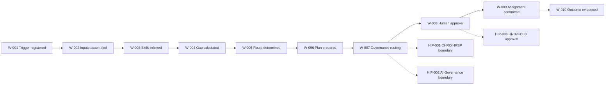
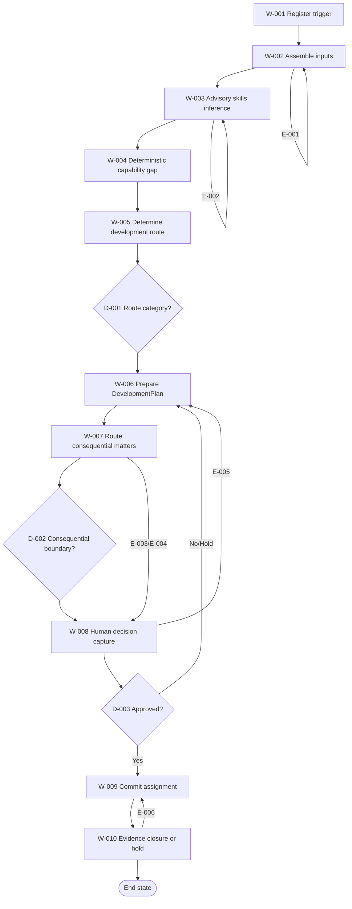

# Executive Summary

This Stage 4 deliverable classifies the Learning & Skills Agent capability for the Talent Design to Evaluate value stream into reusable logical agent capabilities, controls, handovers, decision points, exception paths and explicit human approvals, aligned to the Stage 4 methodology. [SRC-01, Objective]; [SRC-03, section 5.2 Purpose]

The capability objective remains Continuous Workforce Development, with supported outcomes of closing capability gaps faster and cheaper, improving mobility and AI literacy, and keeping ratings human-led. [SRC-03, Part 1 value stream table]

The workflow baseline used for classification is the Stage 3 decomposition from trigger through assignment and closure evidence. This Stage 4 output does not introduce implementation design, model architecture, or interface engineering. [SRC-02, sections 5 to 8]; [SRC-01, Practitioner guidance]

The Stage 4 output identifies nine logical capability agents across Task, Insight, Orchestration, Control and Experience types, and maps them to each workflow step with a control point for every step. [SRC-01, Stage 4 activities items 2, 3 and 6]; [SRC-01, Agent type legend]

One mandatory Stage 4 input could not be evidenced in the workspace: the completed Stage 4 reference example file path. The ABBA reuse catalogue is now available and has been applied to update reuse assessment outcomes with row-level evidence. [SRC-04, Required inputs IN-03 and IN-05]; [SRC-05, Required inputs IN-03 and IN-02]; [SRC-06, rows 2-26, 117-123, 127, 306-312]

This version is finalised for SME review with all currently resolvable quality and consistency actions completed in-repo; remaining open items are explicitly tracked in the Open Questions, Gap Register, and Validation Checklist appendices. [SRC-04, Validation and quality gates before completion]; [SRC-05, Validation and quality assurance checks]

# Overall AI Framework

## Framework Overview

| Framework element | Stage 4 classification statement | Evidence |
|---|---|---|
| Capability objective | Develop the workforce and agent workforce through advisory inference, deterministic gap and route logic, and human-approved assignment. | [SRC-03, section 5.2 Purpose]; [SRC-03, section 5.2 Behaviours] |
| Trigger boundary | Planning OR skills change initiates the workflow. | [SRC-03, section 6.2 Learning & Skills Agent, Generic agent script]; [SRC-02, section 5.1] |
| Human boundary | Consequential people decisions remain human-led; scope-changing agent tuning remains human-approved. | [SRC-03, section 5.2 Human-in-the-loop boundary] |
| Deterministic boundary | Gap and route rules remain deterministic and traceable. | [SRC-03, section 5.2 Deterministic calculation requirements]; [SRC-03, section 3 Tool catalogue] |
| Classification scope | Agent classification is logical capability decomposition for Stage 4, not technical design. | [SRC-01, Practitioner guidance]; [SRC-04, Non-negotiable generation rules] |

## Internal Orchestration View

## Agent Inventory and Classification

| Agent ID | Agent name | Agent type | Primary scope | Reuse outcome | Evidence |
|---|---|---|---|---|---|
| A-001 | Trigger and Context Intake Agent | Orchestration, Task | Register trigger and initialise case context. | Adapted (VA-1088 Learning value stream manager; VA-1129 Development programme orchestrator) | [SRC-06, row 6]; [SRC-06, row 127]; [SRC-02, W01] |
| A-002 | Input Qualification Agent | Task, Control | Assemble and validate required workforce-development inputs. | Combined (VA-1083 Learning needs analyser; VA-1109 Learning operations compliance monitor) | [SRC-06, row 250]; [SRC-06, row 107]; [SRC-02, W02] |
| A-003 | Skills Inference Agent | Insight | Infer demand/supply position as advisory analysis. | Adapted (VA-1084 Skill gap identifier; VA-1015 Skills gap analyser; VA-1269 Skill profile matcher) | [SRC-06, row 2]; [SRC-06, row 207]; [SRC-06, row 167]; [SRC-02, W03] |
| A-004 | Deterministic Gap and Route Agent | Task, Insight | Run deterministic `skills_gap` and `dev_route` logic. | Adapted (VA-1084 Skill gap identifier with deterministic policy thresholds) | [SRC-06, row 2]; [SRC-03, section 5.2 Deterministic calculation requirements]; [SRC-02, W04-W05] |
| A-005 | Development Plan Experience Agent | Experience, Orchestration | Prepare human-consumable DevelopmentPlan recommendation. | Combined (VA-1123/VA-1235 L&D recommendation agent; VA-1125/VA-1237 Development experience agent) | [SRC-06, row 121]; [SRC-06, row 310]; [SRC-06, row 123]; [SRC-06, row 312]; [SRC-02, W06] |
| A-006 | Human Governance Router Agent | Control, Orchestration | Route consequential matters to correct human authority. | Combined (VA-1129 Development programme orchestrator; VA-1233 Mobility workflow manager; VA-1124 Development compliance monitor) | [SRC-06, row 127]; [SRC-06, row 308]; [SRC-06, row 122]; [SRC-02, W07] |
| A-007 | Approval Workflow Agent | Orchestration, Control | Capture explicit HRBP + CLO / L&D decisions and decision evidence. | Adapted (VA-1101 Feedback and certification workflow agent + control adaptation from VA-1124) | [SRC-06, row 19]; [SRC-06, row 122]; [SRC-02, W08] |
| A-008 | Assignment Coordination Agent | Task, Orchestration | Commit approved development route via logical systems of record. | Combined (VA-1119/VA-1231 Development plan creator; VA-1120/VA-1232 Mentoring matcher; VA-1093 Learning path designer) | [SRC-06, row 117]; [SRC-06, row 306]; [SRC-06, row 118]; [SRC-06, row 307]; [SRC-06, row 11]; [SRC-02, W09] |
| A-009 | Outcome Evidence and Learning Agent | Control, Experience | Record confirmation, closure evidence and governance log trail. | Combined (VA-1106 Analytics reporter; VA-1089 L&D ROI and impact analytics agent) | [SRC-06, row 24]; [SRC-06, row 7]; [SRC-02, W10] |

## Framework for Every Agent

| Agent ID | Purpose | Inputs | Outputs | Behaviour | Exceptions handled | Controls | Human interaction | Evidence |
|---|---|---|---|---|---|---|---|---|
| A-001 | Register a valid business trigger and open workflow context. | Planning or skills-change event context. | Trigger record and case context. | Read, Validate, Derive. | E-001 | C-001 | Trigger source confirmation where event ambiguity exists. | [SRC-02, W01]; [SRC-03, section 6.2 Generic agent script] |
| A-002 | Assemble complete supported inputs and flag gaps. | Skills taxonomy, demand/supply, frameworks, telemetry. | Input package and completeness status. | Read, Validate, Transmit. | E-001 | C-002 | Human data-owner clarification where required. | [SRC-02, W02]; [SRC-03, section 5.2 Inputs] |
| A-003 | Produce advisory inference on skill demand/supply. | Prepared input package. | Inference summary for downstream deterministic logic. | Derive, Validate. | E-002 | C-003 | Human review if confidence/fairness concern. | [SRC-02, W03]; [SRC-03, section 5.2 Risks] |
| A-004 | Execute deterministic gap and route calculations. | Demand/supply and agentifiable values. | Gap and route result. | Derive, Validate. | E-001, E-002 | C-004 | Human challenge path if data quality concern. | [SRC-02, W04-W05]; [SRC-03, section 5.2 Deterministic calculation requirements] |
| A-005 | Prepare the DevelopmentPlan recommendation. | Gap, route, contextual workforce evidence. | DevelopmentPlan: capability, gap, route. | Create, Derive, Transmit. | E-002, E-003, E-004 | C-005 | HRBP/CLO-facing recommendation presentation. | [SRC-02, W06]; [SRC-03, section 5.2 Outputs] |
| A-006 | Route consequential matters to the right authority. | DevelopmentPlan and boundary rules. | Escalation packet and routing record. | Validate, Transmit. | E-003, E-004 | C-006 | CHRO/HRBP or AI Governance escalation. | [SRC-02, W07]; [SRC-03, section 5.2 Human-in-the-loop boundary] |
| A-007 | Orchestrate explicit human approval/rejection/hold actions. | Escalation packet and approval evidence. | Decision record and next-step status. | Approve, Validate, Update. | E-005 | C-007 | HRBP + CLO / L&D decision authority. | [SRC-02, W08]; [SRC-03, section 4.3]; [SRC-03, section 4.4] |
| A-008 | Coordinate approved assignment commitment. | Approved development decision. | Assignment commit status in logical systems. | Update, Transmit. | E-006 | C-009 | Human intervention for unresolved commit failures. | [SRC-02, W09]; [SRC-03, section 6.2 Systems of record] |
| A-009 | Capture closure evidence and learning, or controlled hold. | Assignment outcome, confirmations, decision trace. | Closure evidence or hold record. | Create, Update, Validate, Transmit. | E-006 | C-010 | Human confirmation for unresolved closure evidence. | [SRC-02, W10]; [SRC-03, section 4.4 Audit trail schema] |

# End-to-End Workflow

## Workflow Narrative

The classified workflow starts at business trigger, assembles supported inputs, applies advisory insight and deterministic calculations, prepares recommendation output, routes consequential matters for human authority, captures explicit approval, commits approved assignment, and closes only when evidence is complete. [SRC-02, sections 5 to 8]; [SRC-03, section 5.2 Behaviours]

## End-to-End Workflow Diagram

# Workflow Decomposition Catalogue

| Workflow Step ID | Step name | Step objective | Operation | Producing performer | Consuming performer | Business owner | Data owner | Data steward | Source system owner | Inputs | Outputs | Trigger | Related decisions | Related exceptions | Candidate/assigned agent | Agent type | Control point(s) | Evidence reference |
|---|---|---|---|---|---|---|---|---|---|---|---|---|---|---|---|---|---|---|
| W-001 | Register trigger | Open valid case context for capability review. | Read, Derive, Validate | Planning or skills-change source process | A-001 | HRBP + CLO / L&D | Not evidenced (OQ-001) | Not evidenced (OQ-001) | Not evidenced (OQ-001) | Planning or skills-change event | Trigger record | Planning OR skills change | None | E-001 | A-001 | Orchestration, Task | C-001 | [SRC-02, W01]; [SRC-03, section 6.2 Generic agent script] |
| W-002 | Assemble inputs | Build complete and governed input package. | Read, Validate, Transmit | A-002 | A-003/A-004 | HRBP + CLO / L&D | Not evidenced (OQ-001) | Not evidenced (OQ-001) | Not evidenced (OQ-001) | Skills taxonomy, demand/supply, frameworks, telemetry | Input package | W-001 output | None | E-001 | A-002 | Task, Control | C-002 | [SRC-02, W02]; [SRC-03, section 5.2 Inputs] |
| W-003 | Skills inference | Produce advisory demand/supply inference. | Read, Derive, Validate | A-003 | A-004/A-005 | HRBP + CLO / L&D | Not evidenced (OQ-001) | Not evidenced (OQ-001) | Not evidenced (OQ-001) | Input package | Inference result | W-002 output | None | E-002 | A-003 | Insight | C-003 | [SRC-02, W03]; [SRC-03, section 5.2 Deterministic calculation requirements] |
| W-004 | Calculate capability gap | Apply deterministic `skills_gap`. | Derive, Validate | A-004 | A-004/A-005 | HRBP + CLO / L&D | Not evidenced (OQ-001) | Not evidenced (OQ-001) | Not evidenced (OQ-001) | Demand and supply values | Gap result | W-003 output | D-001 | E-001, E-002 | A-004 | Task, Insight | C-004 | [SRC-02, W04]; [SRC-03, section 3 Tool catalogue] |
| W-005 | Determine route | Apply deterministic `dev_route` thresholds. | Derive, Validate | A-004 | A-005 | HRBP + CLO / L&D | Not evidenced (OQ-001) | Not evidenced (OQ-001) | Not evidenced (OQ-001) | Gap result, agentifiable values | Route result | W-004 output | D-001 | E-001 | A-004 | Task, Insight | C-005 | [SRC-02, W05]; [SRC-03, section 5.2 Deterministic calculation requirements] |
| W-006 | Prepare DevelopmentPlan | Create advisory recommendation package for review. | Create, Derive, Transmit | A-005 | A-006/A-007 | HRBP + CLO / L&D | Not evidenced (OQ-001) | Not evidenced (OQ-001) | Not evidenced (OQ-001) | Gap and route results | DevelopmentPlan | W-005 output | D-002 | E-002, E-003, E-004 | A-005 | Experience, Orchestration | C-006 | [SRC-02, W06]; [SRC-03, section 5.2 Outputs] |
| W-007 | Governance routing | Enforce human-governance boundary routing. | Validate, Transmit | A-006 | CHRO/HRBP, AI Governance, A-007 | HRBP + CLO / L&D | Not evidenced (OQ-001) | Not evidenced (OQ-001) | Not evidenced (OQ-001) | DevelopmentPlan and governance rules | Escalation packet | W-006 output | D-002 | E-003, E-004 | A-006 | Control, Orchestration | C-007 | [SRC-02, W07]; [SRC-03, section 5.2 Human-in-the-loop boundary] |
| W-008 | Capture approval decision | Record explicit human approve/reject/hold action. | Approve, Validate, Update | HRBP + CLO / L&D through A-007 | A-008/A-005 | HRBP + CLO / L&D | Not evidenced (OQ-001) | Not evidenced (OQ-001) | Not evidenced (OQ-001) | Approval packet and evidence | Decision record | W-007 output | D-003 | E-005 | A-007 | Orchestration, Control | C-008 | [SRC-02, W08]; [SRC-03, section 4.3]; [SRC-03, section 4.4] |
| W-009 | Commit assignment | Commit approved route to logical systems of record. | Update, Transmit | A-008 | A-009 | HRBP + CLO / L&D | Not evidenced (OQ-001) | Not evidenced (OQ-001) | Not evidenced (OQ-001) | Approved decision | Assignment commit record | W-008 approved output | None | E-006 | A-008 | Task, Orchestration | C-009 | [SRC-02, W09]; [SRC-03, section 6.2 Systems of record] |
| W-010 | Evidence closure or hold | Close only when confirmation and evidence are complete. | Create, Update, Validate, Transmit | A-009 | Governance log consumers and reviewers | HRBP + CLO / L&D | Not evidenced (OQ-001) | Not evidenced (OQ-001) | Not evidenced (OQ-001) | Assignment outcomes, confirmation evidence | Closure evidence or hold record | W-009 output | None | E-006 | A-009 | Control, Experience | C-010 | [SRC-02, W10]; [SRC-03, section 4.4 Audit trail schema] |

# Handover and Interaction Register

| Handover ID | Source | Destination | Transferred artefact/information | Producing performer | Consuming performer | Control owner | Preconditions | Postconditions | Failure mode | Evidence citation |
|---|---|---|---|---|---|---|---|---|---|---|
| H-001 | W-001 | W-002 | Trigger record and capability context | A-001 | A-002 | HRBP + CLO / L&D | Valid trigger captured | Input assembly initiated | Trigger ambiguity or missing context (E-001) | [SRC-02, H01]; [SRC-02, W01-W02] |
| H-002 | W-002 | W-003/W-004 | Input package: taxonomy, demand/supply, frameworks, telemetry | A-002 | A-003/A-004 | HRBP + CLO / L&D | Required inputs available | Inference and deterministic processing enabled | Data/schema incompleteness (E-001) | [SRC-02, H02]; [SRC-03, section 5.2 Inputs] |
| H-003 | W-006 | W-007/W-008 | DevelopmentPlan recommendation packet | A-005 | A-006 and HRBP + CLO / L&D | HRBP + CLO / L&D | Gap and route computed | Recommendation routed for governance and approval | Recommendation quality/confidence concern (E-002) | [SRC-02, H03]; [SRC-02, W06-W08] |
| H-004 | W-007 | CHRO / HRBP | Consequential people-decision escalation packet | A-006 | CHRO / HRBP | CHRO / HRBP | Consequential people-decision condition met | Human-led decision obtained | Escalation not actioned timely (E-003) | [SRC-02, H04]; [SRC-03, section 5.2 Human-in-the-loop boundary] |
| H-005 | W-007 | AI Governance | Scope-changing tuning escalation packet | A-006 | AI Governance | AI Governance | Scope-changing tuning condition met | Approval/rejection evidence captured | Approval not obtained (E-004) | [SRC-02, H05]; [SRC-03, section 5.2 Human-in-the-loop boundary] |
| H-006 | W-008 | W-009 or W-006 | Human decision outcome and rationale | A-007 with HRBP + CLO / L&D decision | A-008 or A-005 | HRBP + CLO / L&D | Decision authority engaged | Approved route proceeds or rework begins | Reject/hold/rework loop (E-005) | [SRC-02, H06]; [SRC-03, section 4.4 Audit trail schema] |
| H-007 | W-009 | W-010 | Assignment commit evidence and confirmation status | A-008 | A-009 | HRBP + CLO / L&D | Approval recorded and commit attempted | Closure evidence preparation starts | Commit/confirmation failure (E-006) | [SRC-02, H07]; [SRC-02, W09-W10] |
| H-008 | W-010 | Governance log endpoint | Action, decision, outcome, learning capture log | A-009 | Governance/audit consumers | AI Governance | Closure or hold status set | Traceability retained for assurance | Incomplete evidence trail (E-006) | [SRC-02, H08]; [SRC-03, section 4.4 Audit trail schema] |

# Decision Catalogue

| Decision ID | Decision name | Triggering step | Decision question | Decision logic/criteria | Required evidence | Decision owner | Approval requirement | Possible outcomes | Downstream impact | Evidence reference |
|---|---|---|---|---|---|---|---|---|---|---|
| D-001 | Route category decision | W-005 | Which development route applies? | `>=0.5 deploy-agent`, `>=0.25 blended`, else upskill/hire. | Gap and agentifiable inputs | Learning & Skills Agent capability logic under business ownership | Human review remains required before consequential action | Deploy-agent, blended, upskill, hire | Determines recommendation content in W-006 | [SRC-02, D01]; [SRC-03, section 5.2 Deterministic calculation requirements] |
| D-002 | Consequential boundary decision | W-007 | Does recommendation cross a consequential people or tuning boundary? | Consequential people decisions routed to CHRO/HRBP; scope-changing tuning to AI Governance. | DevelopmentPlan and boundary checks | CHRO/HRBP or AI Governance depending on boundary | Yes, explicit human authority | Standard path or escalated path | Controls handover and approval routing | [SRC-02, D02]; [SRC-03, section 5.2 Human-in-the-loop boundary] |
| D-003 | Human approval decision | W-008 | Approve, reject, hold or rework? | HRBP + CLO / L&D review recommendation and supporting evidence. | Approval packet, rationale, trace | HRBP + CLO / L&D | Mandatory | Approve, reject, hold, rework | Approve to W-009; reject/hold to W-006 | [SRC-02, D03]; [SRC-03, section 4.3]; [SRC-03, section 4.4] |

# Exception Catalogue

| Exception ID | Exception name | Trigger condition | Affected step(s) | Severity/priority | Containment action | Escalation route | Resolution owner | Closure criteria | Evidence reference |
|---|---|---|---|---|---|---|---|---|---|
| E-001 | Input/schema completeness failure | Required source data unavailable, incomplete, or unresolved. | W-001, W-002, W-004, W-005 | High | Hold and request missing evidence; no inferred replacement facts. | Data/governance clarification path | Not evidenced (OQ-001) | Complete input package available and validated. | [SRC-02, EX-01]; [SRC-03, sections 1.3 and 5.2 Inputs] |
| E-002 | Inference confidence/fairness concern | Advisory inference quality concern that could bias recommendation. | W-003, W-006 | High | Human review and rework before approval submission. | HRBP + CLO / L&D review path | HRBP + CLO / L&D | Recommendation revalidated with evidence. | [SRC-02, EX-02]; [SRC-03, section 5.2 Risks] |
| E-003 | Consequential people-decision boundary breach risk | Recommendation impacts promotion/pay-affecting/performance decisioning. | W-006, W-007, W-009 | Critical | Remove autonomous path; route to CHRO/HRBP. | CHRO / HRBP | CHRO / HRBP | Human-led decision recorded. | [SRC-02, EX-03]; [SRC-03, section 5.2 Human-in-the-loop boundary] |
| E-004 | Scope-changing tuning boundary breach risk | Recommendation requires retraining/tuning that changes scope. | W-007, W-009 | Critical | Route to AI Governance and require approval evidence. | AI Governance | AI Governance | Approval/rejection trace captured. | [SRC-02, EX-04]; [SRC-03, section 5.2 Human-in-the-loop boundary] |
| E-005 | Approval not granted / rework requested | HRBP + CLO / L&D reject, hold or request rework. | W-008 | High | Return to recommendation preparation with rationale. | HRBP + CLO / L&D | HRBP + CLO / L&D | New or amended packet submitted and decided. | [SRC-02, EX-05]; [SRC-03, section 4.4 Audit trail schema] |
| E-006 | Assignment confirmation/closure evidence failure | Commit succeeds partially or evidence insufficient for closure. | W-009, W-010 | High | Keep case open or controlled hold; reroute to assignment handling. | Operational review path | Not evidenced (OQ-002) | Confirmation and evidence complete. | [SRC-02, EX-06]; [SRC-03, section 4.4 Audit trail schema] |

# Human Intervention Points

| HIP ID | Human role | Trigger | Required action | Why human judgement is needed | Input artefacts | Output artefacts | Approval/control linkage | Timing expectation | Evidence reference |
|---|---|---|---|---|---|---|---|---|---|
| HIP-001 | CHRO / HRBP | Consequential people-decision boundary reached in W-007. | Review and decide consequential workforce outcome. | Source mandates human-led handling for consequential people decisions. | Escalation packet, DevelopmentPlan evidence | Human decision record | Linked to D-002, C-007 | Not evidenced (OQ-003) | [SRC-02, HIP-01]; [SRC-03, section 5.2 Human-in-the-loop boundary] |
| HIP-002 | AI Governance | Scope-changing tuning boundary reached in W-007. | Approve or reject tuning/retraining change. | Source assigns AI Governance approval and reversibility control. | Escalation packet, tuning context | Approval or rejection record | Linked to D-002, C-007 | Not evidenced (OQ-003) | [SRC-02, HIP-02]; [SRC-03, section 5.2 Governance & compliance controls] |
| HIP-003 | HRBP + CLO / L&D | Approval stage W-008 reached. | Approve, reject, hold or request rework. | Segregation of duties and human approval are mandatory. | DevelopmentPlan packet and supporting evidence | Human decision with rationale and timestamp | Linked to D-003, C-008 | Not evidenced (OQ-003) | [SRC-02, HIP-03]; [SRC-03, section 4.3]; [SRC-03, section 4.4] |
| HIP-004 | Operational resolver (role not evidenced) | Closure evidence incomplete at W-010. | Determine whether to hold, rework, or close after remediation. | Source indicates unresolved ownership for failed confirmation path. | Closure evidence gap record | Hold/rework decision and next action | Linked to E-006, C-010 | Not evidenced (OQ-002) | [SRC-02, HIP-04]; [SRC-02, EX-06] |

# SME Validation and Confirmation

## Expected SME Validation Scope

| Validation area | Validation question | Expected SME group | Current status | Evidence |
|---|---|---|---|---|
| Classification integrity | Are agent boundaries and type assignments proportionate and non-duplicative? | Capability SME and delivery lead | Pending | [SRC-04, Step 12]; [SRC-05, Step 12] |
| Workflow fidelity | Does W-001 to W-010 reflect the business-operating workflow accurately? | Process SME | Pending | [SRC-02, sections 5 to 7] |
| Governance fidelity | Are control points and human boundaries complete and explicit? | Risk and governance SME | Pending | [SRC-01, activity 6]; [SRC-03, section 5.2 Human-in-the-loop boundary] |
| Decision/exception coverage | Are all material branches represented by D and E catalogues? | Capability SME | Pending | [SRC-04, Step 10]; [SRC-05, Decision and exception modelling rules] |
| Handover clarity | Are handover preconditions, postconditions and failure modes sufficient? | Operating model SME | Pending | [SRC-04, Step 9]; [SRC-05, Handover rules] |
| Reuse assessment | Are the ABBA-mapped reuse selections and final candidate preferences acceptable for sign-off? | Architecture SME | Pending | [SRC-06, rows 2-26, 107, 117-123, 127, 167, 207, 250, 306-312]; [SRC-05, Step 5] |

## SME Confirmation Statements

| Statement | Status | Evidence |
|---|---|---|
| Stage 4 workflow and classification are accepted for this capability. | Pending | [SRC-04, Step 12] |
| Human interventions and approvals are complete and correctly placed. | Pending | [SRC-01, activity 2]; [SRC-01, Common pitfalls] |
| Open questions and gaps are correctly represented with no fabricated assumptions. | Pending | [SRC-04, Non-negotiable generation rules] |

# Stage 4 to Stage 5 Handover

| Handover item | Stage 5 use | Status | Notes | Evidence |
|---|---|---|---|---|
| Approved Stage 4 agent model | Baseline for Stage 5 data modelling by agent and handover. | Ready with open validation | Approval pending SME confirmation. | [SRC-01, Next stage]; [SRC-04, Step 12] |
| Workflow decomposition catalogue | Input to Stage 5 data requirements by workflow step. | Ready | Includes operation, ownership placeholders, controls, decisions and exceptions. | [SRC-01, Outputs of Stage 4]; [SRC-04, Workflow Decomposition guidance] |
| Decision catalogue | Decision-driven data and evidence model definition. | Ready | Includes ownership and outcome impacts. | [SRC-04, Decision Catalogue guidance] |
| Exception catalogue | Exception data, escalation and closure modelling. | Ready | Includes containment, escalation and closure criteria. | [SRC-04, Exception Catalogue guidance] |
| Handover/interaction register | Interface data and state transfer modelling. | Ready | Includes failure modes and control ownership placeholders. | [SRC-04, Handover Register guidance] |
| Control and approval map | Control-point and approval data model alignment. | Ready | Every workflow step has a control point C-001 to C-010. | [SRC-01, activity 6]; [SRC-01, Outputs of Stage 4] |
| Reuse assessment and variance log | Supports reuse decisions and variance management in Stage 5+. | Ready | ABBA catalogue assessed and mapped to A-001 to A-009 with row-level evidence. | [SRC-06, rows 2-26, 107, 117-123, 127, 167, 207, 250, 306-312] |
| Open items register | Prevents silent carry-over of unresolved dependencies. | Ready | See appendices for assumptions, constraints, questions and gaps. | [SRC-04, Quality gate 7] |

# Appendices

## 1. Source Register

| Source ID | Title | File/Location | Role in analysis | Precedence level | Availability | Evidence |
|---|---|---|---|---|---|---|
| SRC-01 | Stage 4 methodology extract | Delivery-Control/Stage_4.md | Primary Stage 4 authority for objective, activities, outputs, controls and pitfalls. | 1 | Available | [SRC-01, Objective to Common pitfalls] |
| SRC-02 | Learning Skills Agent Stage 3 Decompose | Learning-and-Skills-agent/Learning_Skills_Agent_Stage3_Decompose.md | Stage 3 decomposition baseline for workflow, handovers, decisions, exceptions and HIPs. | 2 | Available | [SRC-02, sections 6 to 9] |
| SRC-03 | HR Capability and Full Agent Catalogue v1 | Learning-and-Skills-agent/HR_Capability_and_Full_Agent_Catalogue_v1.md | Authoritative capability facts, controls, deterministic logic and owner patterns. | 2 | Available | [SRC-03, section 5.2 and section 6.2] |
| SRC-04 | HR Stage 4 Instructions | Learning-and-Skills-agent/HR_Stage4_Instructions.md | Mandatory structure, quality gates, identifiers, citation rules and output standard. | 2 | Available | [SRC-04, Required section guidance and validation gates] |
| SRC-05 | HR Stage 4 Skill | Learning-and-Skills-agent/HR_Stage4_Skills.md | Stage 4 generation workflow, modelling rules and mandatory appendix order. | 2 | Available | [SRC-05, Stage 4 workflow and deliverables; Suggested appendix order] |
| SRC-06 | ABBA reuse catalogue | ABBA-Reuse-Agents/Annotated_Agents_H2RList.csv | Required for reuse assessment. | 3 | Available | [SRC-06, rows 2-26, 107, 117-123, 127, 167, 207, 250, 306-312] |
| SRC-07 | Completed Stage 4 example | Reference/PAA-Deliverables/Stage4/Payroll_Assurance_Agent_Stage_4_Classify_Capability_Based.md | Structural reference comparator only. | 4 | Not available in workspace | [SRC-04, IN-05]; [SRC-05, IN-02] |

## 2. Reuse Assessment and Variance Log

| Reuse ID | Workflow area | Candidate logical capability | ABBA match evidence | Reuse outcome | Variance from requirement | Impact | Evidence |
|---|---|---|---|---|---|---|---|
| R-001 | Trigger and input preparation | A-001, A-002 | VA-1088 Learning value stream manager; VA-1129 Development programme orchestrator; VA-1083 Learning needs analyser; VA-1109 Learning operations compliance monitor | Adapted + Combined | Stage 4 uses control-point granularity and ownership model not fully explicit in ABBA entries. | Low | [SRC-06, row 6]; [SRC-06, row 127]; [SRC-06, row 250]; [SRC-06, row 107] |
| R-002 | Inference and deterministic logic | A-003, A-004 | VA-1084 Skill gap identifier; VA-1015 Skills gap analyser; VA-1269 Skill profile matcher | Adapted | ABBA entries do not encode the exact deterministic threshold logic; deterministic route logic remains capability-specific. | Medium | [SRC-06, row 2]; [SRC-06, row 207]; [SRC-06, row 167]; [SRC-03, section 5.2 Deterministic calculation requirements] |
| R-003 | Recommendation and routing | A-005, A-006 | VA-1123/VA-1235 L&D recommendation agent; VA-1125/VA-1237 Development experience agent; VA-1124 Development compliance monitor; VA-1233 Mobility workflow manager | Combined | Stage 4 separates recommendation, governance routing, and consequential escalation as distinct control steps. | Medium | [SRC-06, row 121]; [SRC-06, row 310]; [SRC-06, row 123]; [SRC-06, row 312]; [SRC-06, row 122]; [SRC-06, row 308] |
| R-004 | Approval and assignment | A-007, A-008 | VA-1101 Feedback and certification workflow agent; VA-1119/VA-1231 Development plan creator; VA-1120/VA-1232 Mentoring matcher; VA-1093 Learning path designer | Combined | Human-approval evidence capture and SoD controls are explicit in Stage 4 and extend ABBA workflow patterns. | Low | [SRC-06, row 19]; [SRC-06, row 117]; [SRC-06, row 306]; [SRC-06, row 118]; [SRC-06, row 307]; [SRC-06, row 11] |
| R-005 | Closure evidence and learning | A-009 | VA-1106 Analytics reporter; VA-1089 L&D ROI and impact analytics agent | Adapted | Stage 4 adds controlled-hold closure logic and governance traceability expectations beyond base ABBA analytics roles. | Low | [SRC-06, row 24]; [SRC-06, row 7]; [SRC-02, W10] |

## 3. Assumptions Register

| Assumption ID | Assumption | Rationale | Impact if false | Evidence |
|---|---|---|---|---|
| ASM-001 | Stage 3 W-001 to W-010 sequence is the baseline for Stage 4 classification. | Stage 4 input depends on Stage 3 decomposition outputs. | Workflow and catalogues require remapping. | [SRC-01, Inputs from Stage 3]; [SRC-02, section 6.2] |
| ASM-002 | ABBA candidate mapping is performed by logical capability fit because ABBA taxonomy (Task/Process/Function/Value Stream/Control/Experience) differs from Stage 4 output taxonomy (Task/Insight/Orchestration/Control/Experience). | Source taxonomies differ and require transparent mapping. | Mapping may be refined after SME calibration of classification boundaries. | [SRC-01, Agent type legend]; [SRC-06, rows 2-26, 117-123, 127, 306-312] |
| ASM-003 | Ownership placeholders remain unresolved and are not to be fabricated. | Ownership distinctions are mandatory and evidence-sensitive. | Governance quality risk if assumed incorrectly. | [SRC-04, Ownership terminology rules]; [SRC-05, Ownership terminology rules] |

## 4. Constraints Register

| Constraint ID | Constraint | Impact on completeness | Evidence |
|---|---|---|---|
| CON-001 | ABBA contains overlapping or duplicate-like candidate entries (for example paired entries in 04.03 Talent Development), so final reuse selection requires SME preference and standardisation. | Reuse mapping is evidence-backed but some candidate choices remain preference-driven. | [SRC-06, row 117]; [SRC-06, row 306]; [SRC-06, row 121]; [SRC-06, row 310] |
| CON-002 | Completed Stage 4 example file not available in current workspace. | Structural comparison limited to instruction and skill guidance only. | [SRC-04, IN-05]; [SRC-05, IN-02] |
| CON-003 | Specific data-owner, steward and source-system-owner evidence is incomplete in source pack. | Ownership fields remain unresolved and flagged in open questions and gaps. | [SRC-02, DEP-01 to DEP-08]; [SRC-04, Ownership terminology rules] |
| CON-004 | Mermaid rendered validation tool was not available in this task context. | Static syntax checks applied; rendered parser validation logged as pending. | [SRC-04, Mermaid authoring and validation rules]; [SRC-05, Mermaid authoring and validation rules] |

## 5. Open Questions Register

| Open Question ID | Question | Why it matters | Required owner | Status | Evidence |
|---|---|---|---|---|---|
| OQ-001 | Who are the named business owner, data owner, data steward and source system owner for each workflow step? | Required ownership separation for governance and Stage 5 modelling. | Capability and data governance SMEs | Open | [SRC-04, Ownership terminology rules]; [SRC-02, dependency ownership notes] |
| OQ-002 | Who resolves E-006 assignment confirmation/closure failures operationally? | Closure authority must be explicit for controlled holds and rework. | Operations and governance SMEs | Open | [SRC-02, EX-06]; [SRC-02, HIP-04] |
| OQ-003 | What are approved timing expectations and SLAs for HIP and escalation paths? | Needed for handover enforceability and operational assurance. | Process and service management SMEs | Open | [SRC-02, H04-H06]; [SRC-04, Handover Register guidance] |
| OQ-004 | Is Workforce Skills Agent an approved alias or formal rename for Learning & Skills Agent? | Naming traceability across stages and approvals. | Delivery governance SME | Open | [SRC-02, section 1 Executive Summary naming note]; [SRC-03, section 6.2 Learning & Skills Agent] |

## 6. Gap Register

| Gap ID | Gap description | Impacted section(s) | Impact on confidence/completeness | Resolution action | Evidence |
|---|---|---|---|---|---|
| GAP-001 | Final preference selection among overlapping ABBA candidates is not yet SME-confirmed. | Overall AI Framework; Appendix 2 | Low to medium confidence on final candidate precedence, while reuse evidence itself is present. | Run SME selection workshop and lock preferred ABBA variants per agent. | [SRC-06, row 117]; [SRC-06, row 306]; [SRC-06, row 121]; [SRC-06, row 310] |
| GAP-002 | Missing reference Stage 4 example limits direct structural comparator checks. | Document presentation benchmarking | Low impact due full instruction/skill guidance available | Add reference example and perform comparator pass. | [SRC-04, IN-05]; [SRC-05, IN-02] |
| GAP-003 | Named ownership metadata incomplete for data and source-system roles. | Workflow Decomposition Catalogue; Handover Register | Medium governance confidence | Confirm owners and update catalogues. | [SRC-04, Ownership terminology rules]; [SRC-02, dependency notes] |
| GAP-004 | SME confirmation outcomes not yet recorded. | SME Validation and Confirmation | Deliverable remains draft for review | Run SME walkthrough and capture approvals. | [SRC-04, Step 12]; [SRC-05, Step 12] |
| GAP-005 | Mermaid rendered parser validation not executed because Node.js and npx are not available in the current environment. | Diagram quality assurance | Low technical confidence on rendering portability | Install Node.js (or provide an alternative Mermaid renderer), run mmdc render checks for all Mermaid blocks, then update VAL-14 to Pass/Fail with evidence. | [SRC-04, Mermaid authoring and validation rules] |

## 7. Validation Checklist

| Check ID | Validation check | Result | Evidence |
|---|---|---|---|
| VAL-01 | Required top-level headings are present in required order. | Pass | [SRC-04, Required review-ready document sections] |
| VAL-02 | Mandatory Stage 4 outputs are included. | Pass | [SRC-01, Outputs of Stage 4] |
| VAL-03 | Workflow IDs W-001 to W-010 are unique. | Pass | Internal document check; [SRC-04, Identifier conventions] |
| VAL-04 | Agent IDs A-001 to A-009 are unique. | Pass | Internal document check; [SRC-04, Identifier conventions] |
| VAL-05 | Decision IDs D-001 to D-003 are unique and referenced. | Pass | Internal document check; [SRC-04, Identifier conventions] |
| VAL-06 | Exception IDs E-001 to E-006 are unique and referenced. | Pass | Internal document check; [SRC-04, Identifier conventions] |
| VAL-07 | HIP IDs HIP-001 to HIP-004 are unique and referenced. | Pass | Internal document check; [SRC-04, Identifier conventions] |
| VAL-08 | Every workflow step has an explicit control point. | Pass | C-001 to C-010 assigned per W-step; [SRC-01, activity 6] |
| VAL-09 | Workflow operations use only approved values. | Pass | Read, Create, Update, Transmit, Validate, Approve, Derive used only; [SRC-04, Standard operation field] |
| VAL-10 | Every factual table row includes evidence citation. | Pass | Row-level citation check completed; [SRC-04, Evidence citation standard] |
| VAL-11 | Ownership distinctions preserved without collapsing roles. | Pass with open ownership questions | [SRC-04, Ownership terminology rules]; [OQ-001] |
| VAL-12 | Unresolved items are registered (assumptions, constraints, open questions, gaps). | Pass | Appendices 3 to 6 completed; [SRC-04, Rules for assumptions/constraints/open questions/gaps] |
| VAL-13 | Mermaid syntax static checks completed. | Pass | Fence balance, diagram declaration and ID consistency checked; [SRC-04, Mermaid authoring and validation rules] |
| VAL-14 | Mermaid rendered parser validation completed. | Pending | Not executed: Node.js and npx are unavailable in current environment; logged as GAP-005. | [SRC-04, Mermaid authoring and validation rules] |
| VAL-15 | UK English applied. | Pass | Manual language pass completed; [SRC-04, Review-ready output standard] |
