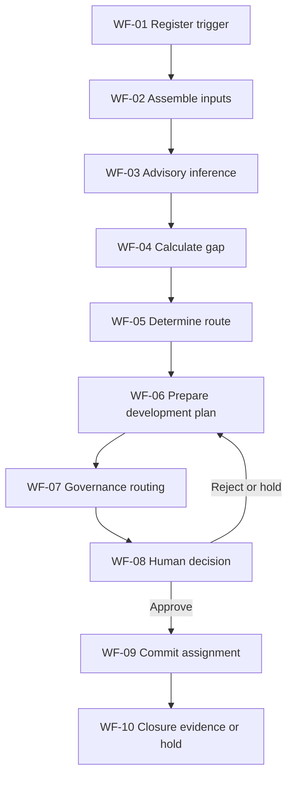

# 1. Document Control

| Field | Value | Evidence Reference |
| --- | --- | --- |
| Skill name and version | stage-6b-solution-design-consolidation-generator v1.0 | [SRC-02, YAML header] |
| Instruction file and version | stage-6b-document-generation.instructions.md v1.0 | [SRC-01, YAML header] |
| Methodology version | Agent Factory Delivery Methodology - Stage 6B (Solution Design Consolidation) | [SRC-01, YAML header]; [SRC-02, metadata] |
| Template version | Stage 6B Markdown structure 1.0 | [SRC-01, YAML header]; [SRC-02, metadata] |
| Generation date | 2026-10-16 | This document |
| Execution environment | VS Code workspace (Windows) | User session context |
| Source-pack fingerprint or source list | SRC-01 to SRC-08 listed in Section 5 | Section 5 |
| Validation-script version | stage6b-validate 1.0 (script file not supplied in workspace) | [SRC-02, metadata.validationScriptVersion]; [CIA-01] |
| Validation outcome | Manual structural and traceability validation completed; automated script execution pending evidence | Section 11; [CIA-01] |
| Deliverable status | Not Build Ready | Section 10; Section 13 |
| Classification | KPMG confidential | [SRC-01, classification]; [SRC-02, license] |

# 2. Contents

- [1. Document Control](#1-document-control)
- [2. Contents](#2-contents)
- [3. Executive Summary](#3-executive-summary)
- [4. Stage 6B Objective and Scope](#4-stage-6b-objective-and-scope)
- [5. Source Inventory and Evidence Map](#5-source-inventory-and-evidence-map)
- [6. Consolidated Solution Design](#6-consolidated-solution-design)
- [7. End-to-End Orchestration Assurance](#7-end-to-end-orchestration-assurance)
- [8. Consolidated Control Coverage](#8-consolidated-control-coverage)
- [9. Unit-Test Coverage Assessment](#9-unit-test-coverage-assessment)
- [10. Readiness Assessment](#10-readiness-assessment)
- [11. Consolidated Issues, Risks and Actions Log](#11-consolidated-issues-risks-and-actions-log)
- [12. Recommended Implementation Technology](#12-recommended-implementation-technology)
- [13. Controls, Evidence and Exit Criteria](#13-controls-evidence-and-exit-criteria)
- [14. Assumptions, Dependencies and Limitations](#14-assumptions-dependencies-and-limitations)
- [15. Appendices (diagrams, matrices, glossary)](#15-appendices-diagrams-matrices-glossary)

# 3. Executive Summary

This deliverable consolidates the Stage 6 component designs for HR-ETG-001 into one end-to-end solution view and validates flow, data continuity, handovers, controls, exceptions, human intervention consistency, and unit-test sufficiency.

Consolidation outcome:

- Components consolidated: 9 baseline components.
- Workflow steps consolidated: 10 (WF-01 to WF-10, source aliases W-001 to W-010).
- Controls mapped: 10 (C01 to C10, source aliases C-001 to C-010).
- Handovers mapped: 8 baseline (H01 to H08, source aliases H-001 to H-008).
- Proposed additions: none.
- Blocking CIA items: 4.

Current status is Not Build Ready because Design Authority approval, automation validation execution evidence, and selected governance ownership evidence are pending.

# 4. Stage 6B Objective and Scope

## 4.1 Objective

Bring all Stage 6 component designs together to confirm they form one coherent, end-to-end solution that meets the business outcome and is ready for build.

Evidence Reference: [SRC-03, section 6B Objective].

## 4.2 Scope

| Scope Area | In Scope | Out of Scope | Evidence Reference |
| --- | --- | --- | --- |
| Consolidation | Stage 6 component consolidation, end-to-end orchestration assurance, control and test coverage assurance | Re-authoring component designs | [SRC-03, section 6B Actions 1-11]; [SRC-01, Stage boundary] |
| Data | Validation against Stage 5B model outputs and handovers | New Stage 5/5B modelling | [SRC-03, section 6B Inputs]; [SRC-04, Sections 4-8] |
| Build readiness | Readiness assessment and recommendation | Stage 7 implementation build | [SRC-03, section 6B Exit criteria]; [SRC-01, Stage boundary] |
| Technology | Recommendation only | Implementation specification | [SRC-01, Non-negotiable rule 6] |

# 5. Source Inventory and Evidence Map

| Source ID | Source Path | Type | Approval Status | Approval Evidence | Primary Use | Evidence Reference |
| --- | --- | --- | --- | --- | --- | --- |
| SRC-01 | Learning-and-Skills-agent/stage-6b-document-generation.instructions.md | Repository instruction authority | Approved for use as instructions file | Explicit instruction file metadata | Stage 6B constraints and format | [SRC-01, YAML header and sections 1-10] |
| SRC-02 | Learning-and-Skills-agent/stage-6b-SKILL.md | Repository procedure authority | Approved for use as skill file | Explicit skill metadata | Stage 6B process and validation checklist | [SRC-02, YAML header and sections 1-13] |
| SRC-03 | Delivery-Control/Stage_6.md | Methodology authority | Approved for methodology use | Stage method artefact in delivery-control | Stage 6B objective, actions, outputs, controls, exit criteria | [SRC-03, section 6B] |
| SRC-04 | Stage 6 Output/HR-ETG-001_Learning_and_Skills_Agent_Stage_6_Detailed_Design_v0.1.md | Stage 6 consolidated design input | Approval not evidenced | No explicit DA approval record supplied | Primary component, control, handover, and test source for consolidation | [SRC-04, sections 6-25] |
| SRC-05 | Stage 5B Output/HR-ETG-001_Learning_and_Skills_Agent_Stages_5_and_5B_Model_and_Data_Model_Consolidation_v0.1.md | Stage 5B data model input | Approval not evidenced | DA status recorded not submitted | Data continuity and model alignment checks | [SRC-05, sections 3-10] |
| SRC-06 | Stage 4 Output/Learning_and_Skills_Agent_Stage_4_Classify.md | Stage 4 classification and orchestration input | Approval pending SME review | Source status explicitly finalised for SME review | Baseline workflow, handovers, exceptions, HIPs | [SRC-06, Executive Summary and registers] |
| SRC-07 | Learning-and-Skills-agent/HR_Capability_and_Full_Agent_Catalogue_v1.md | Capability rules and boundaries input | Approval not evidenced | Approval record not supplied in workspace | Deterministic thresholds and human-boundary constraints | [SRC-04, sections 6 and 11 citing this source] |
| SRC-08 | ABBA-Reuse-Agents/Annotated_Agents_H2RList.csv | ABBA reuse evidence input | Approval not evidenced | Approval record not supplied in workspace | Reuse assessment traceability | [SRC-06, Reuse Assessment tables] |

# 6. Consolidated Solution Design

## 6.1 Component Consolidation Matrix

| Component ID | Source Alias | Classification | Primary Purpose | Primary Trigger | Owner | Consolidation Status | Evidence Reference |
| --- | --- | --- | --- | --- | --- | --- | --- |
| CMP-01 | A-001 | Orchestration, Task | Register valid case context | Planning or skills-change event | Owner: TBC - source required (CIA-02) | Consolidated | [SRC-04, section 9.1 A-001] |
| CMP-02 | A-002 | Task, Control | Assemble governed input package | Case opened | Owner: TBC - source required (CIA-02) | Consolidated | [SRC-04, section 9.1 A-002] |
| CMP-03 | A-003 | Insight | Produce advisory inference | Input package complete | Owner: TBC - source required (CIA-02) | Consolidated | [SRC-04, section 9.1 A-003] |
| CMP-04 | A-004 | Task, Insight | Execute deterministic gap and route logic | Inference and structured inputs available | Owner: TBC - source required (CIA-02) | Consolidated | [SRC-04, sections 9.1 and 11] |
| CMP-05 | A-005 | Experience, Orchestration | Compose development recommendation packet | Route determination complete | Owner: HRBP plus CLO or L&D (working baseline) | Consolidated | [SRC-04, section 9.1 A-005] |
| CMP-06 | A-006 | Control, Orchestration | Route consequential cases | Recommendation packet produced | Owner: TBC - source required (CIA-02) | Consolidated | [SRC-04, section 9.1 A-006] |
| CMP-07 | A-007 | Orchestration, Control | Capture human decision | Escalation or approval packet available | Owner: HRBP plus CLO or L&D (working baseline) | Consolidated | [SRC-04, section 9.1 A-007] |
| CMP-08 | A-008 | Task, Orchestration | Commit approved assignment | Approved decision recorded | Owner: TBC - source required (CIA-02) | Consolidated | [SRC-04, section 9.1 A-008] |
| CMP-09 | A-009 | Control, Experience | Evidence closure or hold | Commit payload and confirmation | Owner: TBC - source required (CIA-02) | Consolidated | [SRC-04, section 9.1 A-009] |

## 6.2 Consolidated Data Continuity Check

| Workflow ID | Source Alias | Core Output | Primary Consumer | Stage 5B Entity Alignment | Continuity Status | Evidence Reference |
| --- | --- | --- | --- | --- | --- | --- |
| WF-01 | W-001 | Case context and trigger record | WF-02 | workflow_case and trigger_event attributes | Pass | [SRC-04, section 10 MAP-001]; [SRC-05, section 5 A-01/A-02] |
| WF-02 | W-002 | Input package | WF-03 and WF-04 | skills_signal demand and supply attributes | Pass | [SRC-04, section 10 MAP-002]; [SRC-05, section 5 A-03/A-04] |
| WF-03 | W-003 | Inference payload | WF-04 and WF-06 | skills_inference_result confidence and summary | Pass with governance gap | [SRC-04, section 10 MAP-003]; [CIA-03] |
| WF-04 | W-004 | Deterministic gap result | WF-05 and WF-06 | capability_gap_result gap_fte | Pass | [SRC-04, section 10 MAP-004] |
| WF-05 | W-005 | Route determination | WF-06 | development_route_result route fields | Pass | [SRC-04, section 10 MAP-005] |
| WF-06 | W-006 | Development plan packet | WF-07 and WF-08 | development_plan logical entity | Pass with canonical destination gap | [SRC-04, section 10 MAP-006]; [SRC-05, section 8 G-04]; [CIA-03] |
| WF-07 | W-007 | Routing or escalation packet | WF-08 and governance recipients | approval and policy linkage | Pass | [SRC-04, sections 9.1 and 17] |
| WF-08 | W-008 | Decision payload | WF-09 or WF-06 rework loop | silver.approval and decision record fields | Pass | [SRC-04, section 10 MAP-007] |
| WF-09 | W-009 | Assignment commit payload | WF-10 | development_assignment and assignment_confirmation linkage | Pass with source-system owner gap | [SRC-04, section 10 MAP-008]; [SRC-05, section 8 G-03]; [CIA-02] |
| WF-10 | W-010 | Closure packet or hold record | Governance consumers | closure_evidence_record | Pass | [SRC-04, section 10 MAP-009] |

## 6.3 Consistency Findings

| Consistency Area | Finding | Status | Evidence Reference |
| --- | --- | --- | --- |
| Language consistency | Deterministic and human-boundary vocabulary is consistent across Stage 4, Stage 5B, and Stage 6 artefacts | Pass | [SRC-06, workflow and decision catalogues]; [SRC-05, sections 4-7]; [SRC-04, sections 11-15] |
| Response consistency | Recommendation, escalation, and closure response patterns are consistently represented | Pass | [SRC-04, section 13] |
| Control consistency | Each workflow step has one mapped control and linked audit evidence pattern | Pass | [SRC-04, sections 8.2 and 16] |

# 7. End-to-End Orchestration Assurance

## 7.1 End-to-End Flow Diagram

Evidence Reference: [SRC-06, End-to-End Workflow Diagram]; [SRC-04, section 8.1].

## 7.2 Handover Assurance Register

| Handover ID | Source Alias | From Workflow | To Workflow | Payload | Acknowledgement Pattern | Failure Behaviour | Status | Evidence Reference |
| --- | --- | --- | --- | --- | --- | --- | --- | --- |
| H01 | H-001 | WF-01 | WF-02 | Trigger context | Case open acknowledgement | Revalidate trigger | Baseline | [SRC-06, H-001]; [SRC-04, section 18 H-001] |
| H02 | H-002 | WF-02 | WF-03 and WF-04 | Input package | Package acceptance acknowledgement | Return for completeness correction | Baseline | [SRC-06, H-002]; [SRC-04, section 18 H-002] |
| H03 | H-003 | WF-06 | WF-07 and WF-08 | Recommendation packet | Receipt acknowledgement | Rework recommendation | Baseline | [SRC-06, H-003]; [SRC-04, section 18 H-003] |
| H04 | H-004 | WF-07 | Human authority route | Consequential people packet | Escalation acknowledgement | Hold until decision | Baseline | [SRC-06, H-004]; [SRC-04, section 18 H-004] |
| H05 | H-005 | WF-07 | AI governance route | Scope-change packet | Escalation acknowledgement | Hold until approval | Baseline | [SRC-06, H-005]; [SRC-04, section 18 H-005] |
| H06 | H-006 | WF-08 | WF-09 or WF-06 | Decision payload | Decision capture acknowledgement | Rework loop | Baseline | [SRC-06, H-006]; [SRC-04, section 18 H-006] |
| H07 | H-007 | WF-09 | WF-10 | Commit payload | Commit confirmation acknowledgement | Retry or hold path | Baseline | [SRC-06, H-007]; [SRC-04, section 18 H-007] |
| H08 | H-008 | WF-10 | Governance consumer endpoint | Closure packet | Logged receipt acknowledgement | Hold until closure evidence complete | Baseline | [SRC-06, H-008]; [SRC-04, section 18 H-008] |

## 7.3 Exception and Human Intervention Assurance

| Assurance Area | Consolidation Result | Coverage Status | Evidence Reference |
| --- | --- | --- | --- |
| Exception paths | EXC-01 to EXC-06 (source aliases E-001 to E-006) are represented with escalation and closure behaviour | Pass | [SRC-04, section 14]; [SRC-06, Exception Catalogue] |
| Human intervention points | HIP-01 to HIP-04 are represented and linked to decision rights and controls | Pass with owner gap on HIP-04 | [SRC-04, section 15]; [CIA-02] |

# 8. Consolidated Control Coverage

| Workflow ID | Source Alias | Control ID | Source Alias | Control Objective | Evidence Output | Owner | Coverage Status | Evidence Reference |
| --- | --- | --- | --- | --- | --- | --- | --- | --- |
| WF-01 | W-001 | C01 | C-001 | Trigger validity | Trigger validity record | Owner: TBC - source required (CIA-02) | Covered | [SRC-04, section 16 C-001] |
| WF-02 | W-002 | C02 | C-002 | Input completeness | Completeness status | Owner: TBC - source required (CIA-02) | Covered | [SRC-04, section 16 C-002] |
| WF-03 | W-003 | C03 | C-003 | Inference governance | Inference review record | Owner: TBC - source required (CIA-02) | Covered | [SRC-04, section 16 C-003] |
| WF-04 | W-004 | C04 | C-004 | Gap arithmetic correctness | Gap reconciliation evidence | Owner: TBC - source required (CIA-02) | Covered | [SRC-04, section 16 C-004] |
| WF-05 | W-005 | C05 | C-005 | Route threshold correctness | Route validation evidence | Owner: TBC - source required (CIA-02) | Covered | [SRC-04, section 16 C-005] |
| WF-06 | W-006 | C06 | C-006 | Recommendation integrity | Recommendation packet integrity record | Owner: HRBP plus CLO or L&D (working baseline) | Covered | [SRC-04, section 16 C-006] |
| WF-07 | W-007 | C07 | C-007 | Consequential boundary enforcement | Routing decision record | Owner: TBC - source required (CIA-02) | Covered | [SRC-04, section 16 C-007] |
| WF-08 | W-008 | C08 | C-008 | Approval capture | Signed decision record | Owner: HRBP plus CLO or L&D (working baseline) | Covered | [SRC-04, section 16 C-008] |
| WF-09 | W-009 | C09 | C-009 | Commit confirmation | Commit evidence record | Owner: TBC - source required (CIA-02) | Covered | [SRC-04, section 16 C-009] |
| WF-10 | W-010 | C10 | C-010 | Closure evidence completeness | Closure evidence packet | Owner: TBC - source required (CIA-02) | Covered | [SRC-04, section 16 C-010] |

Coverage Summary:

- Workflow steps covered: 10 of 10.
- Uncontrolled steps: 0.
- Proposed controls: 0.

# 9. Unit-Test Coverage Assessment

| Test ID | Type | Coverage Target | Source Alias | Normal or Exception Scenario | Coverage Status | Evidence Reference |
| --- | --- | --- | --- | --- | --- | --- |
| UT-01 | Component | CMP-01 | A-001 | Normal trigger registration | Covered | [SRC-04, section 21 UT-001N] |
| UT-02 | Component | CMP-01 | A-001 | Exception invalid trigger | Covered | [SRC-04, section 21 UT-001E] |
| UT-03 | Component | CMP-02 | A-002 | Normal package completeness | Covered | [SRC-04, section 21 UT-002N] |
| UT-04 | Component | CMP-02 | A-002 | Exception missing inputs | Covered | [SRC-04, section 21 UT-002E] |
| UT-05 | Component | CMP-03 | A-003 | Normal inference generation | Covered | [SRC-04, section 21 UT-003N] |
| UT-06 | Component | CMP-03 | A-003 | Exception low-confidence route | Covered | [SRC-04, section 21 UT-003E] |
| UT-07 | Component | CMP-04 | A-004 | Normal deterministic gap calculation | Covered | [SRC-04, section 21 UT-004N] |
| UT-08 | Component | CMP-04 | A-004 | Exception deterministic input validation | Covered | [SRC-04, section 21 UT-004E] |
| UT-09 | Component | CMP-04 | A-004 | Normal route threshold behaviour | Covered | [SRC-04, section 21 UT-005N] |
| UT-10 | Component | CMP-04 | A-004 | Exception route boundary behaviour | Covered | [SRC-04, section 21 UT-005E] |
| UT-11 | Component | CMP-05 | A-005 | Normal recommendation packet integrity | Covered | [SRC-04, section 21 UT-006N] |
| UT-12 | Component | CMP-05 | A-005 | Exception recommendation rework path | Covered | [SRC-04, section 21 UT-006E] |
| UT-13 | Component | CMP-06 | A-006 | Normal standard routing path | Covered | [SRC-04, section 21 UT-007N] |
| UT-14 | Component | CMP-06 | A-006 | Exception consequential routing path | Covered | [SRC-04, section 21 UT-007E] |
| UT-15 | Component | CMP-07 | A-007 | Normal approval capture | Covered | [SRC-04, section 21 UT-008N] |
| UT-16 | Component | CMP-07 | A-007 | Exception hold or reject loop | Covered | [SRC-04, section 21 UT-008E] |
| UT-17 | Component | CMP-08 | A-008 | Normal assignment commit | Covered | [SRC-04, section 21 UT-009N] |
| UT-18 | Component | CMP-08 | A-008 | Exception commit failure path | Covered | [SRC-04, section 21 UT-009E] |
| UT-19 | Component | CMP-09 | A-009 | Normal closure evidence creation | Covered | [SRC-04, section 21 UT-010N] |
| UT-20 | Component | CMP-09 | A-009 | Exception closure hold path | Covered | [SRC-04, section 21 UT-010E] |
| UT-21 | Handover | H01 to H08 | H-001 to H-008 | Handover contract integrity and failure behaviour | Covered | [SRC-04, section 21 UT-011N and UT-011E] |

Coverage Summary:

- Components with both normal and exception tests: 9 of 9.
- Workflow steps with linked tests: 10 of 10.
- Controls with linked tests: 10 of 10.
- Handovers with linked tests: 8 of 8.
- Coverage gaps identified: 0 functional coverage gaps; governance evidence gaps captured in CIA log.

# 10. Readiness Assessment

| Exit Criterion | Status | Evidence Reference | CIA Link |
| --- | --- | --- | --- |
| All items resolved | Pending - evidence required | Open CIA entries remain | CIA-01, CIA-02, CIA-03, CIA-04 |
| Design Authority approval | Pending - evidence required | No DA approval record in supplied sources | CIA-04 |
| Build ready confirmed | Not confirmed | Blocking governance and approval evidence remains | CIA-01, CIA-02, CIA-04 |
| Deliverable ready for onward use following Stage 6B consolidation | Partially ready for review; not build ready | Structural consolidation complete, readiness blockers open | CIA-01, CIA-02, CIA-04 |

Readiness Conclusion: Not Build Ready.

# 11. Consolidated Issues, Risks and Actions Log

| CIA ID | Type | Description | Impacted Scope | Severity | Blocking | Owner | Required Action | Status | Evidence Reference |
| --- | --- | --- | --- | --- | --- | --- | --- | --- | --- |
| CIA-01 | Issue | Automated validation checker execution evidence is unavailable because no stage6b validator script artefact is supplied in workspace | Validation outcome assurance and repeatability | High | Yes | Owner: TBC - source required | Provide or confirm approved Stage 6B validation script and execute; attach results in next issue | Open | [SRC-02, validationScriptVersion metadata]; workspace file discovery result |
| CIA-02 | Risk | Named ownership for multiple controls, components, and closure resolver remains not evidenced in authoritative sources | Control accountability, audit ownership, and HIP-04 operation | High | Yes | Owner: TBC - source required | Confirm named owners or approved role owners for C01 to C05, C07, C09, C10, CMP-01, CMP-02, CMP-03, CMP-04, CMP-06, CMP-08, CMP-09, and HIP-04 | Open | [SRC-04, sections 15-16]; [SRC-05, section 8 G-01 to G-03 and G-07] |
| CIA-03 | Issue | Canonical destination and governance for selected agent-created entities remains partially unresolved | Data continuity governance for WF-03, WF-06, WF-09 | Medium | No | Design authority forum (pending evidence) | Confirm canonical admission or approved logical destination for development_plan and skills_inference_result; confirm source-system owner for assignment confirmation | Open | [SRC-04, section 10 MAP-003/MAP-006/MAP-008]; [SRC-05, section 8 G-03/G-04] |
| CIA-04 | Action | Stage 6B Design Authority review and approval evidence not yet supplied | Formal exit criteria and build readiness decision | High | Yes | Factory Design Authority (pending evidence) | Submit Stage 6B pack for DA review and record decision outcome with date and conditions | Open | [SRC-03, Design Authority approval text]; [SRC-05, section 10 DA-01 not submitted] |

# 12. Recommended Implementation Technology

This section provides a recommendation only and does not prescribe implementation specifications.

| Option ID | Option | Fit to Consolidated Design Criteria | Dependencies and Constraints | Decision Position | Evidence Reference |
| --- | --- | --- | --- | --- | --- |
| DEC-01 | Human-centred workflow platform plus deterministic rules service plus governed AI-assist component | Strong fit to required split between deterministic rules, human approvals, and advisory AI behaviour | Requires explicit control-evidence capture and role-based governance integration | Recommended as reference architecture pattern, pending enterprise standards confirmation | [SRC-03, Stage 6B objective and controls]; [SRC-04, sections 11-16] |
| DEC-02 | Fully autonomous orchestration with minimal human gates | Does not fit mandatory human-boundary requirements | Conflicts with consequential and governance intervention controls | Not recommended | [SRC-04, sections 14-15]; [SRC-06, HIP register] |
| DEC-03 | Manual-only process with no AI-assist | Partially fits control needs but weakly fits objective for continuous workforce-development acceleration | Reduces expected capability outcome benefits | Not recommended | [SRC-03, Stage 6B objective]; [SRC-06, capability objective] |

Open decision dependencies:

- Enterprise technology standards for selected platform pattern are not supplied in current source pack (CIA-01 linkage for validation evidence and CIA-04 for approval forum confirmation).

# 13. Controls, Evidence and Exit Criteria

## 13.1 Stage 6B Control and Evidence Status

| Control and Evidence Requirement | Status | Evidence Reference | CIA Link |
| --- | --- | --- | --- |
| Consolidation review by design lead | Pending - evidence required | No explicit signed review record supplied | CIA-04 |
| SME visibility | Pending - evidence required | Upstream artefacts indicate pending SME confirmations | [SRC-06, SME Validation and Confirmation section] | CIA-04 |
| Design Authority review and approval | Pending - evidence required | No approved DA record supplied | [SRC-05, section 10 DA-01 status] | CIA-04 |
| Evidence of alignment to business outcome | Evidenced at design level | Stage 6 and Stage 4 objective alignment trace | [SRC-04, sections 2 and 7]; [SRC-06, Executive Summary and Overall AI Framework] | None |

## 13.2 Exit Criteria Position

| Exit Criterion from Stage 6B | Position | Evidence Reference | CIA Link |
| --- | --- | --- | --- |
| All items resolved | Not met | Open CIA log entries remain | CIA-01, CIA-02, CIA-03, CIA-04 |
| Design Authority approval | Not met | Approval not evidenced in supplied sources | CIA-04 |
| Build ready confirmed | Not met | Blocking items remain open | CIA-01, CIA-02, CIA-04 |

# 14. Assumptions, Dependencies and Limitations

| Assumption ID | Category | Statement | Evidence Status | Challenge Outcome | Impact if Wrong | Evidence Reference |
| --- | --- | --- | --- | --- | --- | --- |
| ASM-01 | Assumption | Stage 6 component designs are the fixed baseline for Stage 6B consolidation | Evidenced | Accepted | Consolidation would require restart if baseline changes materially | [SRC-01, Stage boundary]; [SRC-04, full document] |
| ASM-02 | Assumption | Stage 5B model can be used as working baseline even where DA approval is pending | Partially evidenced | Accepted with risk recorded | Canonical admission gaps remain open for selected entities | [SRC-05, section 1 and section 10]; [CIA-03] |
| ASM-03 | Dependency | DA forum will provide explicit decision record for Stage 6B | Not evidenced | Open dependency | Build readiness cannot be confirmed without DA evidence | [CIA-04] |
| ASM-04 | Limitation | No automated stage6b validator artefact is available in workspace for execution evidence | Evidenced | Recorded as blocker | Validation repeatability evidence remains incomplete | [CIA-01] |

# 15. Appendices (diagrams, matrices, glossary)

## 15.1 Supporting Artefacts in This Folder

| Artefact | Purpose | File Name |
| --- | --- | --- |
| Source inventory and evidence map | Detailed source register and usage map | HR-ETG-001_Stage6B_Source_Inventory_and_Evidence_Map_v0.1.md |
| Component consolidation matrix | Component-level consolidation detail | HR-ETG-001_Stage6B_Component_Consolidation_Matrix_v0.1.md |
| Control coverage map | WF-to-control trace | HR-ETG-001_Stage6B_Control_Coverage_Map_v0.1.md |
| Unit test coverage assessment | Consolidated unit-test trace | HR-ETG-001_Stage6B_Unit_Test_Coverage_Assessment_v0.1.md |
| Consolidated issues and actions log | CIA working log | HR-ETG-001_Stage6B_Consolidated_Issues_Risks_Actions_Log_v0.1.md |
| Workflow diagrams | End-to-end and exception flow views | HR-ETG-001_Stage6B_Workflow_Diagrams_v0.1.md |

## 15.2 Glossary

| Term | Meaning |
| --- | --- |
| CIA | Consolidated Issue, Risk or Action record for Stage 6B |
| CMP | Consolidated component identifier |
| WF | Consolidated workflow-step identifier |
| HIP | Human intervention point |
| DA | Design Authority |

---

Classification: KPMG confidential
