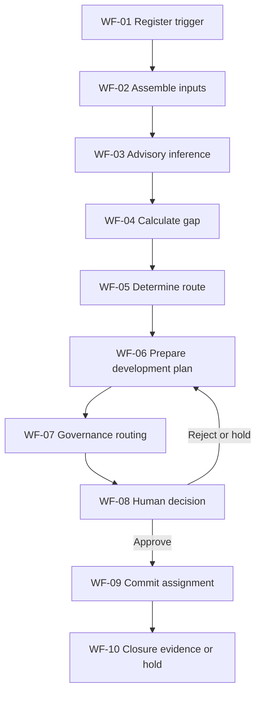
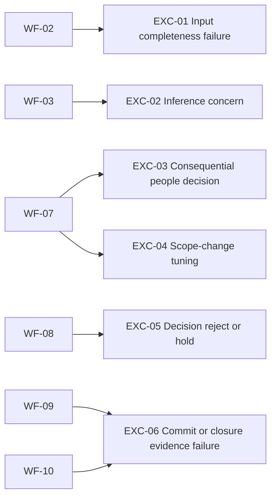

# HR-ETG-001 Stage 6B Workflow Diagrams (v0.1)

## End-to-End Workflow

Evidence Reference: [SRC-06, End-to-End Workflow Diagram]; [SRC-04, section 8.1].

## Exception and Escalation Overlay

Evidence Reference: [SRC-04, section 14]; [SRC-06, Exception Catalogue].

Classification: KPMG confidential
